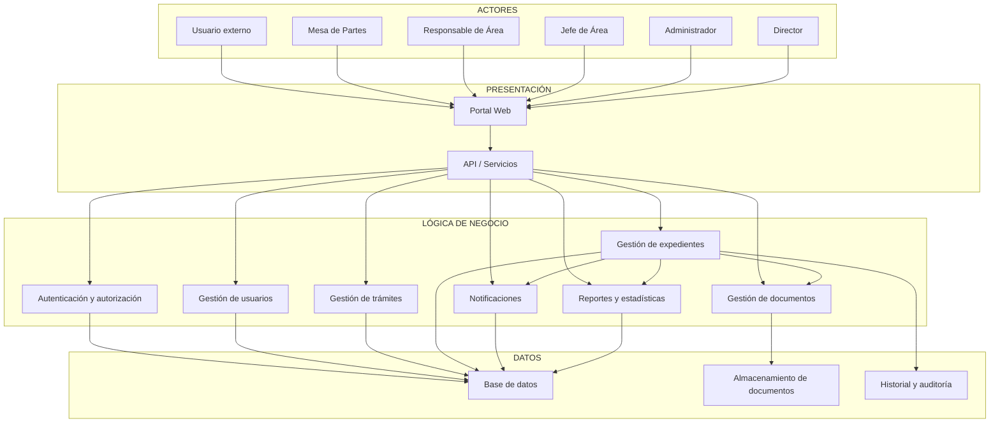
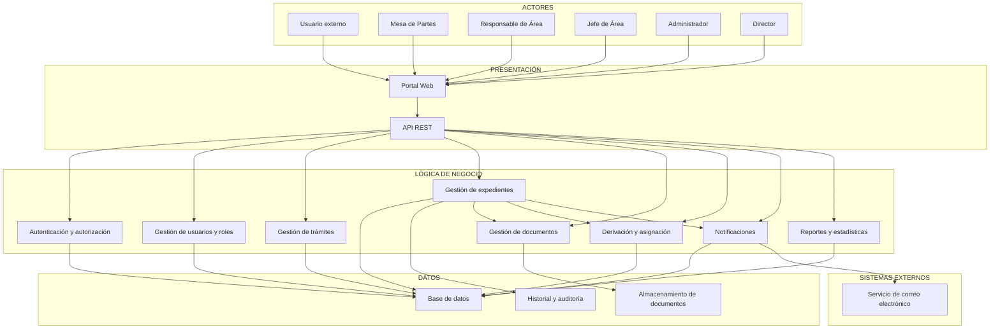

# Arquitectura inicial del sistema

## Diagrama de arquitectura



## Arquitectura en capas

```text
┌────────────────────────────────────────────────────┐
│                  PRESENTACIÓN                      │
│                                                    │
│              Portal Web / Interfaz                │
│                    API REST                       │
└────────────────────────┬───────────────────────────┘
                         ↓
┌────────────────────────────────────────────────────┐
│                LÓGICA DE NEGOCIO                  │
│                                                    │
│ Autenticación y autorización                       │
│ Gestión de usuarios y roles                        │
│ Gestión de trámites                                │
│ Gestión de expedientes                             │
│ Gestión de documentos                              │
│ Derivación y asignación de expedientes             │
│ Notificaciones                                     │
│ Reportes y estadísticas                            │
└────────────────────────┬───────────────────────────┘
                         ↓
┌────────────────────────────────────────────────────┐
│                      DATOS                         │
│                                                    │
│ Base de datos                                      │
│ Documentos digitales                               │
│ Historial y auditoría                              │
└────────────────────────────────────────────────────┘
```

## Diagrama final de arquitectura inicial

