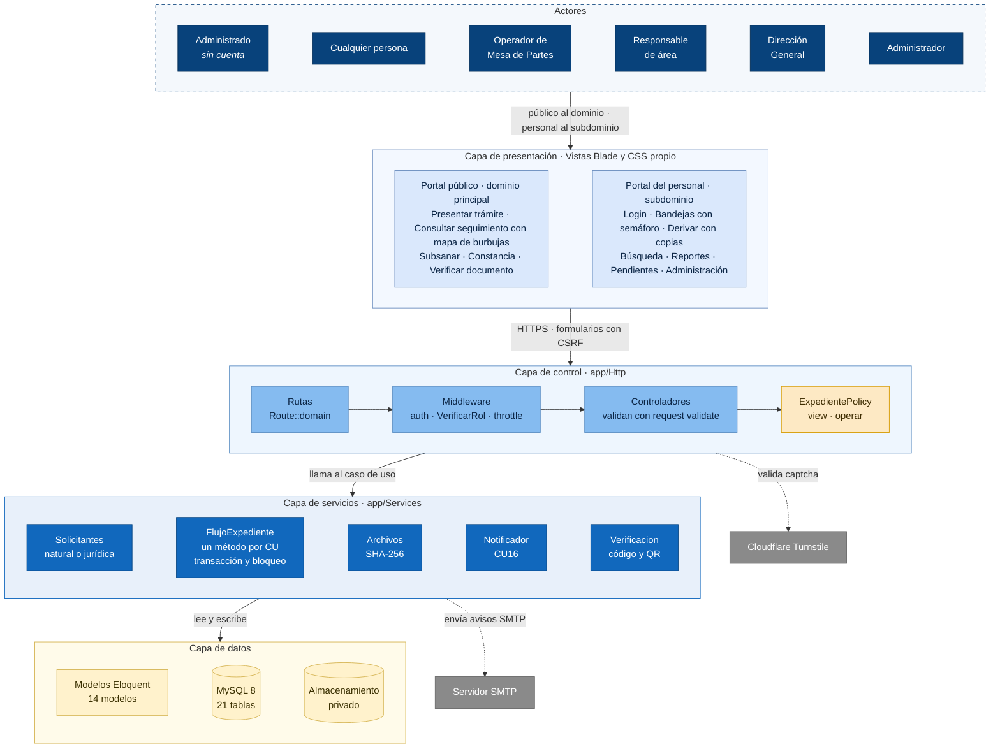

# Arquitectura del sistema

Arquitectura del sistema **Mesa de Partes Virtual** tal como está construido (Laravel 13 y MySQL).

## Diagrama de arquitectura



## Arquitectura en capas

```text
┌────────────────────────────────────────────────────────┐
│ PRESENTACIÓN                                           │
│ Vistas Blade + CSS · portal público y del personal     │
└───────────────────────────┬────────────────────────────┘
                            ↓
┌────────────────────────────────────────────────────────┐
│ CONTROL                                                │
│ Rutas · Controladores · Validación                     │
│ Middleware VerificarRol · ExpedientePolicy · throttle  │
└───────────────────────────┬────────────────────────────┘
                            ↓
┌────────────────────────────────────────────────────────┐
│ SERVICIOS (lógica de negocio)                          │
│ FlujoExpediente · Notificador · Archivos · Verificacion│
└───────────────────────────┬────────────────────────────┘
                            ↓
┌────────────────────────────────────────────────────────┐
│ DATOS                                                  │
│ Modelos Eloquent · Migraciones · MySQL · archivos │
└────────────────────────────────────────────────────────┘
```

Cada capa solo llama a la de abajo. Las vistas no consultan la base de datos por su cuenta: reciben los datos que les pasa el controlador.

## Relación con ICONIX

| Elemento de robustez (ICONIX) | Dónde está en el código |
|---|---|
| Boundary (pantalla) | Vista Blade (`resources/views`) |
| Control | Controlador + método de `FlujoExpediente` |
| Entity | Modelo Eloquent (`app/Models`) y su tabla |
