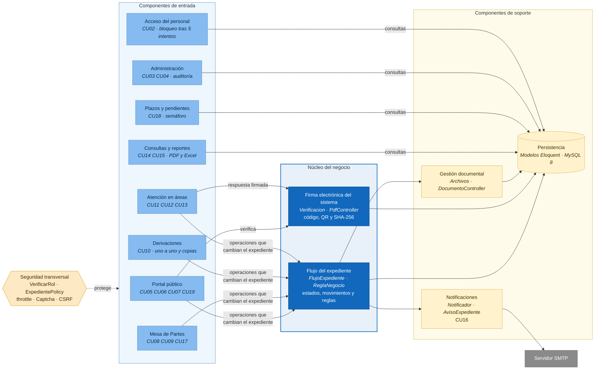

# Componentes arquitectónicos

## 1. Objetivo

Identificar los componentes del sistema construido y sus responsabilidades.

## 2. Componentes principales

| Componente | Responsabilidad | Clases principales |
|---|---|---|
| Portal público | Formulario sin cuenta, consulta, subsanación y verificación. | `TramiteExternoController`, `VerificacionController`, `PdfController` |
| Acceso del personal | Login en el subdominio, bloqueo tras 5 intentos. | `Auth/SesionController` |
| Mesa de Partes | Bandeja, recepción, observación, registro presencial. | `MesaPartesController` |
| Derivaciones | Derivar a un área destino con copias para conocimiento. | `DerivacionController`, `CopiaController` |
| Atención en áreas | Confirmar recepción, avances y respuesta. | `AreaController` |
| Flujo del expediente | Reglas de cada caso de uso, estados y movimientos. | `FlujoExpediente`, `ReglaNegocio` |
| Gestión documental | Guardar y descargar archivos con permisos y huella. | `Archivos`, `DocumentoController` |
| Firma electrónica del sistema | Códigos, QR, verificación y PDF. | `Verificacion`, `PdfController` |
| Notificaciones | Correos al administrado. | `Notificador`, `AvisoExpediente` |
| Plazos y pendientes | Semáforo por días hábiles y panel de pendientes. | `PendientesController`, `config/plazos.php` |
| Consultas y reportes | Búsqueda, reportes en PDF y Excel (.xlsx). | `BusquedaController`, `ReporteController` |
| Administración | Usuarios, áreas, tipos de documento y auditoría. | `Admin/*Controller`, `RegistroAuditoria` |
| Seguridad | Roles, permisos por expediente, límites de peticiones y captcha. | `VerificarRol`, `ExpedientePolicy`, `Captcha` |
| Persistencia | Modelos y tablas. | `app/Models/*`, migraciones, MySQL |

## 3. Interacción entre componentes

Los controladores reciben la petición, validan y consultan a Seguridad. Las operaciones que cambian un expediente pasan siempre por Flujo del expediente, que usa Gestión documental para los archivos, Notificaciones para los correos y Persistencia para los datos. La firma electrónica se genera sola al crear constancias y respuestas, y se consulta desde el portal público.

## 4. Diagrama de componentes

## 5. Consideraciones

Los componentes son agrupaciones lógicas dentro del monolito en capas; no se despliegan por separado.
