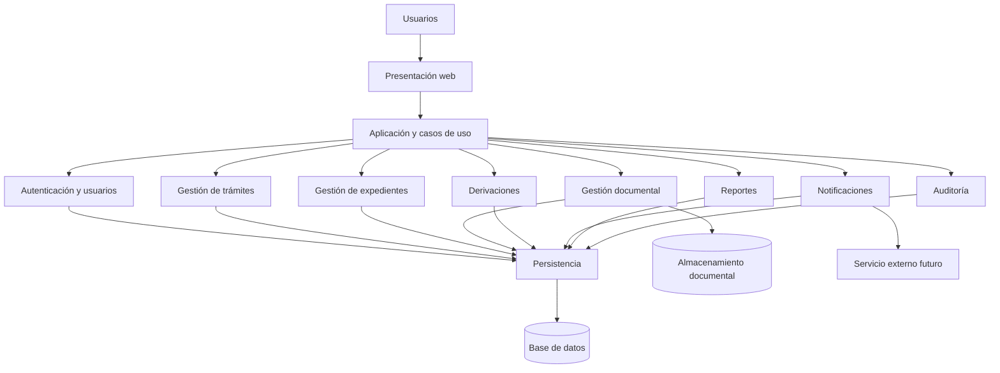

# Componentes arquitectónicos

## 1. Objetivo

Identificar los principales componentes del sistema de Mesa de Partes Virtual del IESTP Manuel Antonio Hierro Pozo – Ayacucho y describir sus responsabilidades e interacciones.

## 2. Componentes principales

| Componente | Responsabilidad |
|---|---|
| Presentación web | Proporcionar las interfaces para los distintos usuarios. |
| Autenticación y usuarios | Gestionar el acceso, los roles y los permisos. |
| Gestión de trámites | Registrar y consultar solicitudes. |
| Gestión de expedientes | Crear expedientes y controlar su estado. |
| Gestión documental | Registrar, adjuntar y consultar documentos. |
| Derivaciones | Asignar expedientes a áreas y responsables. |
| Notificaciones | Comunicar cambios relevantes del trámite. |
| Reportes | Generar consultas e informes de gestión. |
| Auditoría | Registrar las acciones relevantes realizadas en el sistema. |
| Persistencia | Guardar y recuperar los datos del sistema. |

## 3. Interacción entre componentes

El usuario interactúa con la presentación web. Esta solicita operaciones a la capa de aplicación, que coordina los casos de uso y las reglas del dominio.

Los componentes funcionales utilizan contratos para acceder a las operaciones de persistencia y a los servicios externos. La infraestructura implementa los mecanismos técnicos correspondientes.

Por ejemplo, al registrar una solicitud, el sistema valida la información, registra los documentos asociados y crea el expediente cuando corresponda según las reglas del trámite.

## 4. Diagrama de componentes

## 5. Consideraciones

Los componentes representan una propuesta lógica inicial; no implican que cada uno deba desplegarse como un servicio independiente. La solución mantiene el estilo de monolito modular y el enfoque de Clean Architecture.