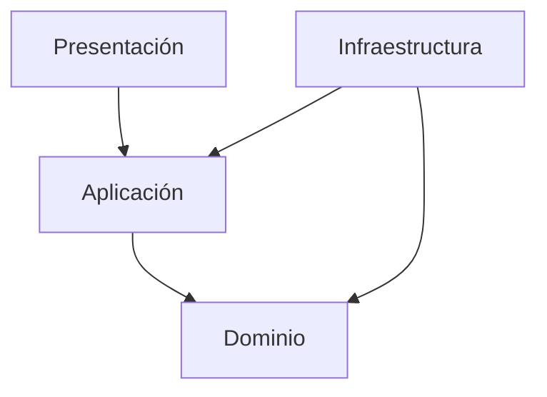

# Enfoque arquitectónico: Clean Architecture

## 1. Descripción

Clean Architecture es un enfoque que organiza el software en capas con responsabilidades diferenciadas. Su objetivo es mantener las reglas del negocio independientes de la interfaz, la base de datos y los servicios externos.

Para el sistema de Mesa de Partes Virtual, este enfoque permitirá separar la gestión de trámites y expedientes de los detalles tecnológicos.

## 2. Capas propuestas

### 2.1. Dominio

Contiene las entidades, reglas y conceptos principales del negocio.

**Ejemplos:**
- Usuario.
- Trámite.
- Expediente.
- Documento.
- Área responsable.

### 2.2. Aplicación

Contiene los casos de uso que coordinan las operaciones del sistema.

**Ejemplos:**
- Registrar una solicitud.
- Registrar un expediente.
- Derivar un expediente.
- Consultar el estado de un trámite.
- Generar un reporte.

### 2.3. Infraestructura

Contiene los mecanismos técnicos que permiten almacenar información y comunicarse con servicios externos.

**Ejemplos:**
- Implementación del acceso a la base de datos.
- Almacenamiento de documentos.
- Servicio de notificaciones.
- Integraciones institucionales futuras.

### 2.4. Presentación

Contiene los elementos mediante los cuales los usuarios interactúan con el sistema.

**Ejemplos:**
- Portal web.
- Formularios de registro de trámites.
- Pantalla de seguimiento de expedientes.
- Panel de administración.

## 3. Regla de dependencias

Las dependencias del diseño deben dirigirse hacia las capas internas. El dominio no debe depender de la base de datos, de la interfaz web ni de servicios externos.

La infraestructura implementará los contratos que necesiten las capas internas.

## 4. Diagrama de capas

**Nota:** Las flechas representan dependencias de diseño. Las implementaciones concretas de infraestructura deben respetar la regla de dependencias de Clean Architecture.

## 5. Beneficios para el proyecto

- Separación de las reglas del negocio y la tecnología.
- Mayor facilidad para probar los casos de uso.
- Mantenimiento más sencillo.
- Posibilidad de cambiar mecanismos de almacenamiento sin modificar las reglas centrales.
- Preparación para futuras integraciones institucionales.

## 6. Consideraciones

Clean Architecture es el enfoque de diseño propuesto para organizar internamente los módulos del monolito modular. Su adopción se plantea como una decisión arquitectónica inicial y deberá validarse durante el desarrollo.