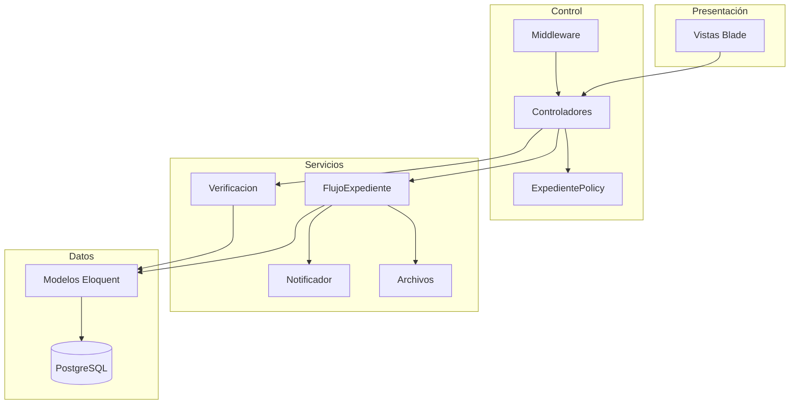

# Enfoque arquitectónico

## 1. Descripción

El sistema sigue un enfoque **orientado a objetos y dirigido por casos de uso**:

- El análisis y el diseño se hicieron con **ICONIX**: casos de uso, robustez, secuencia, clases y base de datos.
- Cada caso de uso se implementa como un método de la capa de servicios (`FlujoExpediente`), llamado por un controlador.
- Cada caso de uso tiene una especificación en `specs/` con criterios de aceptación "Dado / Cuando / Entonces" enlazados a pruebas automáticas. Es una práctica de **desarrollo guiado por especificaciones (SDD)** que apoya a ICONIX.

## 2. Capas

### 2.1. Presentación
Vistas Blade (`resources/views`) y CSS propio. Formularios con validación, mensajes y diseño adaptable al celular.

### 2.2. Control
Rutas (`routes/web.php`), controladores, middleware `VerificarRol`, política `ExpedientePolicy` y límites de peticiones (`throttle`). Validan la entrada y deciden quién puede hacer qué.

### 2.3. Servicios (lógica de negocio)
- `FlujoExpediente`: presentar, recepcionar, observar, derivar, confirmar recepción, registrar avance, responder, registrar presencial y subsanar. Revisa los estados permitidos y lanza `ReglaNegocio` si no se cumplen.
- `Notificador`: envía los correos de cada evento (CU16).
- `Archivos`: guarda los archivos en almacenamiento privado y calcula su huella SHA-256.
- `Verificacion`: códigos de verificación, QR y búsqueda del documento firmado (CU19).

### 2.4. Datos
Modelos Eloquent (`Expediente`, `Movimiento`, `Observacion`, `Respuesta`, `Copia`, `DocumentoAdjunto`, `Administrado`, `Usuario`, `Area`, etc.), migraciones y PostgreSQL.

## 3. Inyección de dependencias

Laravel crea los servicios y los entrega a los controladores por su constructor. Por ejemplo, `FlujoExpediente` recibe `Archivos` y `Notificador`. Esto facilita las pruebas, donde el correo y el disco se reemplazan por versiones falsas (`Notification::fake()`, `Storage::fake()`).

## 4. Regla de dependencias

```text
Presentación → Control → Servicios → Datos
```

Ninguna capa llama a una superior. Las vistas no contienen reglas de negocio.

## 5. Diagrama



## 6. Beneficios para el proyecto

- Trazabilidad directa: caso de uso de ICONIX → especificación → método del servicio → prueba.
- Las reglas del trámite están en un solo archivo de servicio, no repartidas en las pantallas.
- Cualquier miembro del equipo encuentra rápido dónde cambiar algo.

## 7. Enfoques evaluados y no adoptados

| Enfoque | Por qué no se adoptó ahora |
|---|---|
| Clean Architecture | Requiere entidades propias, interfaces y repositorios para no depender de Laravel. Para este tamaño añade capas sin un beneficio visible para el usuario. Queda como mejora futura. |
| Microservicios | El hosting compartido no lo permite y el dominio es uno solo. |
| SPA (Angular o React) + API REST | Necesita compilar con Node.js y mantener dos aplicaciones; Blade cubre la necesidad. |
