# Enfoque arquitectónico: Clean Architecture

## 1. Descripción

Clean Architecture (Arquitectura Limpia) es un enfoque de diseño de software que organiza una aplicación en capas con responsabilidades diferenciadas. Su principal objetivo es mantener las reglas del negocio independientes de los detalles tecnológicos, como las interfaces de usuario, las bases de datos y los servicios externos.

Para el Sistema Integral de Mesa de Partes Virtual y Gestión de Expedientes del Instituto de Educación Superior Tecnológico Público Manuel Antonio Hierro Pozo – Ayacucho, este enfoque permitirá separar las operaciones relacionadas con la recepción, registro, derivación y seguimiento de trámites de los mecanismos tecnológicos utilizados para implementarlas.

La arquitectura se organizará en cuatro capas principales: Presentación, Aplicación, Dominio e Infraestructura. Además, se utilizará un mecanismo de inyección de dependencias para conectar las implementaciones concretas con los contratos definidos en las capas internas.

## 2. Capas propuestas

### 2.1. Dominio

Es el núcleo de la arquitectura y contiene las entidades, modelos, reglas de negocio y contratos que representan los conceptos fundamentales del sistema.

Su responsabilidad es establecer las reglas que deben cumplirse durante la gestión de solicitudes y expedientes, sin depender de tecnologías externas.

**Modelos y entidades principales:**

- Usuario: representa a las personas que interactúan con el sistema.
- Rol: define los permisos y responsabilidades de cada tipo de usuario.
- Solicitud: representa una petición presentada ante la institución.
- TipoTrámite: clasifica las solicitudes según su naturaleza.
- Expediente: representa el registro administrativo generado durante la recepción de una solicitud.
- Documento: representa los archivos asociados a un trámite.
- ÁreaResponsable: identifica las unidades encargadas de atender los expedientes.
- Derivación: representa el envío de un expediente hacia un área responsable.
- SeguimientoTrámite: registra los cambios de estado y las acciones realizadas durante la atención.

**Reglas de negocio principales:**

- Validación de los datos de las solicitudes.
- Reglas para la recepción y generación de expedientes.
- Control de los estados y transiciones de los trámites.
- Validación de las operaciones según los permisos correspondientes.
- Registro de las acciones relacionadas con la trazabilidad de los expedientes.

**Contratos o puertos:**

- Repositorio de solicitudes.
- Repositorio de expedientes.
- Repositorio de usuarios.
- Repositorio de documentos.
- Servicio de registro de recepción.
- Servicio de notificaciones.

Estos contratos definen las operaciones que necesitan las capas internas, sin especificar cómo se implementarán técnicamente.

### 2.2. Aplicación

Contiene los casos de uso que coordinan las operaciones del sistema. Se encarga de ejecutar los procesos solicitados por los usuarios, utilizando las entidades y los contratos definidos en el dominio.

**Casos de uso principales:**

- Registrar una solicitud.
- Consultar solicitudes.
- Recibir y registrar un expediente.
- Validar documentos presentados.
- Derivar un expediente a un área responsable.
- Asignar un expediente a un responsable.
- Registrar observaciones y subsanaciones.
- Consultar el estado de un trámite.
- Registrar cambios en el seguimiento.
- Gestionar usuarios y permisos.
- Generar reportes y estadísticas.
- Enviar notificaciones relacionadas con los trámites.

Los casos de uso no deben acceder directamente a una base de datos ni depender de implementaciones concretas de infraestructura. Para realizar sus operaciones utilizan los contratos definidos por el dominio.

### 2.3. Infraestructura

Contiene las implementaciones técnicas necesarias para que el sistema pueda almacenar información, gestionar documentos y comunicarse con servicios externos.

Su función es implementar los contratos definidos en las capas internas, proporcionando los mecanismos concretos que permiten ejecutar las operaciones del sistema.

**Componentes principales:**

- Repositorios: implementan las operaciones de almacenamiento y consulta de solicitudes, expedientes y usuarios.
- Acceso a datos: permite la comunicación con el sistema gestor de base de datos.
- Almacenamiento documental: administra los archivos adjuntos y documentos asociados a los expedientes.
- Servicio de notificaciones: permite enviar avisos relacionados con los cambios de estado de los trámites.
- Autenticación y autorización: implementa los mecanismos técnicos para verificar la identidad y los permisos de los usuarios.
- Auditoría: permite conservar los registros de las operaciones realizadas en el sistema.
- Integraciones externas: permiten incorporar servicios institucionales cuando sean necesarios.

Las implementaciones concretas podrán sustituirse sin modificar las reglas principales del dominio ni los casos de uso.

### 2.4. Presentación

Contiene los componentes visuales mediante los cuales los usuarios interactúan con el sistema. Su responsabilidad es mostrar la información, recibir los datos ingresados y comunicar las acciones solicitadas a la capa de aplicación.

La interfaz web se desarrollará utilizando Angular y TypeScript.

**Componentes principales:**

- Portal del usuario: permite acceder al sistema y gestionar las solicitudes propias.
- Formulario de registro: permite ingresar los datos de una solicitud y adjuntar documentos.
- Panel de Mesa de Partes: permite revisar, validar y registrar la recepción de solicitudes.
- Panel de gestión de expedientes: permite consultar, derivar y atender expedientes.
- Módulo de seguimiento: permite consultar el estado y el historial de los trámites.
- Panel administrativo: permite gestionar usuarios, roles y configuraciones.
- Módulo de reportes: permite visualizar información estadística sobre la gestión de los trámites.

La capa de presentación se comunicará con los servicios de aplicación mediante los mecanismos de comunicación establecidos para el sistema.

## 3. Contratos, adaptadores e inyección de dependencias

Para mantener la independencia entre las capas, se utilizará el principio de inversión de dependencias.

Los contratos o puertos se definirán en las capas internas, principalmente en el dominio. Las implementaciones concretas estarán ubicadas en infraestructura.

Por ejemplo, el dominio puede definir un contrato denominado `RepositorioSolicitudes`, mientras que infraestructura proporcionará una implementación concreta encargada de almacenar y recuperar las solicitudes.

De esta manera, los casos de uso trabajan con contratos y no necesitan conocer los detalles de la base de datos utilizada.

La inyección de dependencias permitirá registrar y conectar las implementaciones concretas con los contratos correspondientes mediante una raíz de composición.

En la aplicación web Angular, esta configuración se realizará mediante `app.config.ts`. Para el backend, se utilizará el mecanismo de configuración e inyección de dependencias correspondiente a su entorno de ejecución.

## 4. Regla de dependencias

La regla fundamental de Clean Architecture establece que las dependencias del código deben dirigirse hacia las capas internas.

Esto significa que:

1. El dominio no debe depender de las capas externas ni de tecnologías específicas.
2. La aplicación utiliza los modelos y contratos definidos en el dominio.
3. La presentación invoca los casos de uso de la aplicación, sin implementar directamente las reglas del negocio.
4. La infraestructura implementa los contratos definidos por las capas internas.
5. Los adaptadores concretos pueden sustituirse sin modificar las reglas centrales del sistema.

La comunicación entre las capas debe respetar esta separación de responsabilidades. El flujo de ejecución de una operación no debe confundirse con la dirección de las dependencias del código.

## 5. Diagrama de arquitectura

El siguiente diagrama representa la organización propuesta para el sistema, mostrando las responsabilidades de cada capa, sus principales componentes y las relaciones entre los contratos y sus implementaciones.

```mermaid
flowchart TB
    U["Usuario del sistema"]

    subgraph SISTEMA["«aplicación» Mesa de Partes Virtual"]
        direction TB

        subgraph EXT["ADAPTADORES Y FRAMEWORKS"]
            direction TB

            subgraph PRES["PRESENTACIÓN — Angular / TypeScript"]
                direction TB
                P1["Portal del usuario"]
                P2["Registro de solicitudes"]
                P3["Panel de Mesa de Partes"]
                P4["Gestión y seguimiento de expedientes"]
                P5["Panel administrativo y reportes"]
            end

            subgraph APP["APLICACIÓN — Casos de uso"]
                direction TB
                A1["RegistrarSolicitudCasoUso"]
                A2["ConsultarSolicitudesCasoUso"]
                A3["RecibirExpedienteCasoUso"]
                A4["DerivarExpedienteCasoUso"]
                A5["ConsultarSeguimientoCasoUso"]
                A6["GenerarReporteCasoUso"]
            end

            subgraph DOM["DOMINIO — Núcleo del negocio"]
                direction LR

                subgraph MODELOS["Modelos y reglas"]
                    direction TB
                    D1["Usuario y Rol"]
                    D2["Solicitud y TipoTrámite"]
                    D3["Expediente"]
                    D4["Documento"]
                    D5["ÁreaResponsable y Derivación"]
                    D6["SeguimientoTrámite"]
                end

                subgraph CONTRATOS["Contratos — Puertos"]
                    direction TB
                    C1["RepositorioSolicitudes"]
                    C2["RepositorioExpedientes"]
                    C3["RepositorioUsuarios"]
                    C4["RepositorioDocumentos"]
                    C5["ServicioNotificaciones"]
                end
            end

            subgraph INF["INFRAESTRUCTURA — Adaptadores"]
                direction TB
                I1["RepositorioSolicitudesImpl"]
                I2["RepositorioExpedientesImpl"]
                I3["RepositorioUsuariosImpl"]
                I4["RepositorioDocumentosImpl"]
                I5["ServicioNotificacionesImpl"]
                I6["Adaptadores de servicios externos"]
            end

            ROOT["«raíz de composición»<br/>Configuración e inyección de dependencias"]
        end
    end

    DB[("Base de datos")]
    FS[("Almacenamiento documental")]
    EXT2["Servicios externos<br/>Correo e integraciones institucionales"]

    U --> P1
    U --> P2
    U --> P3
    U --> P4
    U --> P5

    P1 --> A1
    P2 --> A1
    P3 --> A3
    P4 --> A4
    P4 --> A5
    P5 --> A6

    A1 -.-> D2
    A2 -.-> D2
    A3 -.-> D3
    A4 -.-> D5
    A5 -.-> D6
    A6 -.-> CONTRATOS

    I1 -.-> C1
    I2 -.-> C2
    I3 -.-> C3
    I4 -.-> C4
    I5 -.-> C5

    ROOT -.-> APP
    ROOT -.-> INF

    I1 --> DB
    I2 --> DB
    I3 --> DB
    I4 --> FS
    I5 --> EXT2
    I6 --> EXT2

    classDef core fill:#fff0bd,stroke:#d99b00,color:#222
    classDef application fill:#d9f5d5,stroke:#329b45,color:#222
    classDef presentation fill:#dcecff,stroke:#2878c8,color:#222
    classDef infrastructure fill:#eadcff,stroke:#8752c5,color:#222

    class DOM core
    class APP application
    class PRES presentation
    class INF infrastructure
```

**Leyenda del diagrama:**

- Las flechas continuas representan llamadas o flujos de ejecución.
- Las flechas discontinuas representan dependencias de código o implementación de contratos.
- Los modelos y contratos del dominio constituyen el núcleo de la arquitectura.
- Los adaptadores de infraestructura implementan los contratos definidos por las capas internas.
- La raíz de composición registra las dependencias y conecta las implementaciones con los casos de uso.

## 6. Beneficios para el proyecto

La aplicación de Clean Architecture aportará los siguientes beneficios:

- **Separación de responsabilidades:** cada capa tendrá funciones específicas y claramente delimitadas.
- **Independencia tecnológica:** las reglas del negocio no dependerán directamente de la interfaz, la base de datos o los servicios externos.
- **Facilidad de pruebas:** los casos de uso podrán probarse utilizando implementaciones simuladas de los contratos.
- **Mantenibilidad:** los cambios en una implementación concreta no obligarán a modificar todas las capas.
- **Escalabilidad funcional:** permitirá incorporar nuevos módulos y operaciones sin concentrar toda la lógica en una sola parte del sistema.
- **Flexibilidad:** facilitará sustituir los mecanismos de almacenamiento, notificación y comunicación cuando las necesidades institucionales lo requieran.

## 7. Consideraciones

Clean Architecture constituye el enfoque arquitectónico propuesto para organizar internamente los módulos del monolito modular de Mesa de Partes Virtual.

La arquitectura planteada establece una separación entre presentación, aplicación, dominio e infraestructura, manteniendo las reglas del negocio independientes de los detalles tecnológicos.

Su implementación se desarrollará progresivamente, verificando que los componentes y las relaciones entre las capas respeten los principios de separación de responsabilidades e inversión de dependencias.

Los componentes representados corresponden a la arquitectura objetivo del sistema. Su inclusión en el diagrama no significa que todos se encuentren implementados actualmente, sino que forman parte de la estructura prevista para el desarrollo.