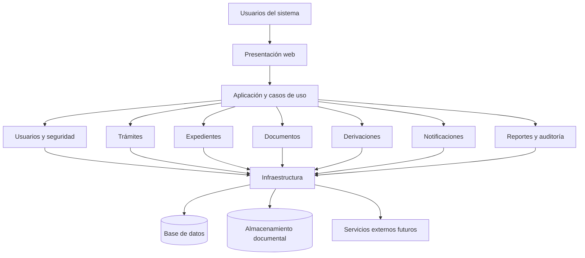

# Estilo arquitectónico

## 1. Estilo seleccionado

Se selecciona el estilo de **monolito modular** para el sistema de Mesa de Partes Virtual del IESTP Manuel Antonio Hierro Pozo – Ayacucho.

Este estilo organiza las funcionalidades en módulos con responsabilidades definidas, pero mantiene la solución como una aplicación que se construye y despliega de manera conjunta.

## 2. Justificación

El monolito modular es apropiado para la etapa inicial del proyecto porque permite organizar las funcionalidades sin añadir la complejidad operativa de múltiples servicios independientes.

Además, facilita la separación de responsabilidades y el mantenimiento de los módulos.

## 3. Módulos principales

- **Usuarios y seguridad:** autenticación, roles y permisos.
- **Trámites:** registro y consulta de solicitudes.
- **Expedientes:** creación, seguimiento y control de estados.
- **Documentos:** registro, adjuntos y consulta de archivos.
- **Derivaciones:** asignación de expedientes a áreas y responsables.
- **Notificaciones:** comunicación de cambios relevantes.
- **Reportes:** consultas e informes de gestión.
- **Auditoría:** historial de acciones realizadas.

## 4. Diagrama del estilo arquitectónico

## 5. Ventajas

- Organización por responsabilidades funcionales.
- Menor complejidad de despliegue inicial.
- Facilidad para mantener y probar los módulos.
- Posibilidad de evolucionar la solución según las necesidades institucionales.

## 6. Consideraciones

Los módulos deberán mantener límites claros y evitar dependencias innecesarias entre sí. La integración con servicios externos se implementará cuando se definan sus requisitos.

La selección del monolito modular constituye una propuesta arquitectónica inicial, sujeta a validación durante el desarrollo del proyecto.