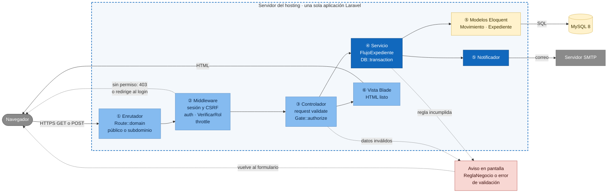

# Estilo arquitectónico

## 1. Estilo seleccionado

**Monolito en capas.** El sistema es una sola aplicación Laravel que se construye, se instala y se ejecuta junta en el hosting del instituto. Por dentro se organiza en cuatro capas: presentación, control, servicios y datos (ver [arquitectura del sistema](arquitectura-inicial.md)).

No expone una API REST ni tiene un frontend separado: las páginas se generan en el servidor con Blade. Los datos se guardan en una única base de datos **MySQL**.

## 2. Justificación

- **Hosting compartido:** el hosting de la DREA permite PHP y una base de datos, pero no varios servicios, colas ni Node.js.
- **Un solo dominio de negocio:** todo gira alrededor del expediente y su recorrido; dividirlo en servicios no aporta.
- **Equipo pequeño y plazo corto:** cinco estudiantes y entrega el 20/12/2026. Laravel ya trae la estructura en capas que todos conocen.
- **Transacciones simples:** una sola base de datos permite recepcionar, derivar y registrar el movimiento en la misma transacción.
- **Mantenimiento por el instituto:** el área de TI recibe un solo sistema, con una guía de instalación.

## 3. Agrupación funcional

Aunque el código se organiza por capas (no por módulos), las funciones se agrupan así, siguiendo los paquetes de casos de uso de ICONIX:

| Grupo | Casos de uso | Controladores | Servicios |
|---|---|---|---|
| Acceso y seguridad | CU02, CU03, CU04 | `Auth/SesionController`, `Admin/*` | — |
| Administrado | CU05, CU06, CU07, CU19 | `TramiteExternoController`, `VerificacionController`, `PdfController` | `FlujoExpediente`, `Verificacion`, `Archivos` |
| Mesa de Partes | CU08, CU09, CU10, CU17 | `MesaPartesController`, `DerivacionController` | `FlujoExpediente` |
| Áreas | CU10, CU11, CU12, CU13 | `AreaController`, `CopiaController`, `DocumentoController` | `FlujoExpediente`, `Archivos` |
| Consultas y reportes | CU14, CU15, CU18 | `BusquedaController`, `ReporteController`, `PendientesController` | — |
| Notificaciones | CU16 | (lo llama `FlujoExpediente`) | `Notificador` |

## 4. Diagrama del estilo arquitectónico

### 4.1. Descripción del flujo

1. El navegador pide una página o envía un formulario.
2. El middleware revisa el subdominio, la sesión, el rol y el límite de peticiones.
3. El controlador valida los datos y consulta la política de permisos.
4. Llama al método del servicio que corresponde al caso de uso, que trabaja dentro de una transacción.
5. El servicio actualiza los modelos, registra el movimiento y pide al Notificador el correo.
6. El controlador devuelve una vista Blade o redirige con un mensaje.

## 5. Ventajas

- Una sola instalación y una sola base de datos.
- Cada caso de uso tiene un lugar claro en el código.
- Rápido en celulares, porque el HTML llega listo.
- Fácil de probar de punta a punta con PHPUnit.

## 6. Consideraciones

- Al crecer el sistema, la organización por tipo de archivo puede volverse grande; la evolución natural es un **monolito modular** (carpetas por grupo funcional).
- La lógica de negocio depende de Eloquent; separarla del framework (**Clean Architecture**) queda como mejora futura.
