# Estilo arquitectónico

## 1. Estilo seleccionado

Se selecciona el estilo arquitectónico de **monolito modular** para el Sistema Integral de Mesa de Partes Virtual y Gestión de Expedientes del Instituto de Educación Superior Tecnológico Público Manuel Antonio Hierro Pozo – Ayacucho.

Este estilo organiza las funcionalidades del sistema en módulos independientes desde el punto de vista de sus responsabilidades, pero mantiene la solución como una única aplicación backend que se construye, ejecuta y despliega de manera conjunta.

La arquitectura estará compuesta por un cliente web desarrollado con Angular 18 y un backend organizado modularmente, que expondrá sus funcionalidades mediante una API REST.

Internamente, el backend estará organizado en tres capas principales:

- **Presentación:** recibe las solicitudes HTTP, valida las entradas y devuelve respuestas.
- **Lógica de negocio:** contiene los servicios y operaciones correspondientes a cada módulo.
- **Acceso a datos:** implementa la persistencia y las consultas mediante repositorios.

La información del sistema se almacenará en una única base de datos PostgreSQL, compartida por los módulos a través de una capa de acceso a datos.

## 2. Justificación

El monolito modular es apropiado para la etapa inicial del proyecto porque permite organizar las funcionalidades sin añadir la complejidad operativa de múltiples servicios independientes.

Además, facilita la separación de responsabilidades, el mantenimiento de los módulos y la integración de las operaciones relacionadas con la gestión documental y administrativa.

Entre las razones para seleccionar este estilo se encuentran:

- Permite desarrollar y desplegar el backend como una sola aplicación.
- Facilita la organización del código en módulos funcionales.
- Permite compartir mecanismos de acceso a datos y servicios transversales.
- Simplifica la comunicación entre módulos mediante sus servicios correspondientes.
- Facilita la implementación de transacciones sobre una única base de datos.
- Permite incorporar nuevas funcionalidades sin distribuir inicialmente el sistema en múltiples servicios.

## 3. Módulos principales

El backend estará organizado en los siguientes módulos funcionales:

### 3.1. Usuarios y seguridad

Se encarga de la autenticación, administración de usuarios, gestión de roles y control de permisos de acceso al sistema.

### 3.2. Trámites

Gestiona el registro, validación y consulta de las solicitudes presentadas por los usuarios.

### 3.3. Expedientes

Se encarga de la recepción, generación, administración y control de los estados de los expedientes.

### 3.4. Documentos

Gestiona los documentos asociados a las solicitudes y expedientes, incluyendo el registro de archivos adjuntos y su consulta.

### 3.5. Derivaciones

Permite asignar y derivar expedientes hacia las áreas responsables para su correspondiente atención.

### 3.6. Seguimiento

Registra y permite consultar los cambios de estado, movimientos e historial de atención de los trámites.

### 3.7. Notificaciones

Gestiona los avisos relacionados con la recepción, derivación, observaciones y cambios relevantes en el estado de los expedientes.

### 3.8. Reportes y auditoría

Permite generar consultas e informes de gestión, además de conservar registros de las acciones realizadas por los usuarios.

## 4. Diagrama del estilo arquitectónico

El siguiente diagrama representa la organización del monolito modular, mostrando los actores que interactúan con el sistema, el cliente web, las capas internas del backend, los módulos funcionales, el acceso compartido a datos y los servicios externos.

```mermaid
flowchart TB

    %% ACTORES DEL SISTEMA
    U1["Solicitante"]
    U2["Personal de Mesa de Partes"]
    U3["Responsable de área"]
    U4["Administrador"]

    %% CLIENTE WEB
    WEB["CLIENTE WEB<br/>Angular 18 - TypeScript<br/>Portal institucional"]

    U1 --> WEB
    U2 --> WEB
    U3 --> WEB
    U4 --> WEB

    %% BACKEND MONOLITICO
    subgraph BACKEND["«monolito modular» Mesa de Partes Virtual - Backend API REST"]
        direction TB

        MW["Middlewares y servicios transversales<br/>CORS - autenticación - autorización - validación de entrada - manejo de errores - logging"]

        %% CAPA DE PRESENTACION
        subgraph PRESENTACION["1. CAPA DE PRESENTACIÓN — API REST"]
            direction LR

            subgraph M1["Módulo usuarios y seguridad"]
                direction TB
                R1["usuarios.routes"]
                C1["usuarios.controller"]
                R1 --> C1
            end

            subgraph M2["Módulo trámites"]
                direction TB
                R2["tramites.routes"]
                C2["tramites.controller"]
                R2 --> C2
            end

            subgraph M3["Módulo expedientes"]
                direction TB
                R3["expedientes.routes"]
                C3["expedientes.controller"]
                R3 --> C3
            end

            subgraph M4["Módulo documentos"]
                direction TB
                R4["documentos.routes"]
                C4["documentos.controller"]
                R4 --> C4
            end

            subgraph M5["Módulo derivaciones"]
                direction TB
                R5["derivaciones.routes"]
                C5["derivaciones.controller"]
                R5 --> C5
            end

            subgraph M6["Módulo seguimiento"]
                direction TB
                R6["seguimiento.routes"]
                C6["seguimiento.controller"]
                R6 --> C6
            end

            subgraph M7["Módulo notificaciones"]
                direction TB
                R7["notificaciones.routes"]
                C7["notificaciones.controller"]
                R7 --> C7
            end

            subgraph M8["Módulo reportes y auditoría"]
                direction TB
                R8["reportes.routes"]
                C8["reportes.controller"]
                R8 --> C8
            end
        end

        %% CAPA DE NEGOCIO
        subgraph NEGOCIO["2. CAPA DE LÓGICA DE NEGOCIO"]
            direction LR
            S1["usuarios.service<br/>Usuarios, roles y permisos"]
            S2["tramites.service<br/>Registro y validación"]
            S3["expedientes.service<br/>Recepción y estados"]
            S4["documentos.service<br/>Gestión documental"]
            S5["derivaciones.service<br/>Asignación y derivación"]
            S6["seguimiento.service<br/>Historial de trámites"]
            S7["notificaciones.service<br/>Avisos y alertas"]
            S8["reportes.service<br/>Informes y auditoría"]
        end

        %% CAPA DE DATOS
        subgraph DATOS["3. CAPA DE ACCESO A DATOS"]
            direction LR
            P1["usuarios.repository"]
            P2["tramites.repository"]
            P3["expedientes.repository"]
            P4["documentos.repository"]
            P5["derivaciones.repository"]
            P6["seguimiento.repository"]
            P7["notificaciones.repository"]
            P8["auditoria.repository"]
        end

        %% ACCESO COMPARTIDO
        SHARED["ACCESO A DATOS COMPARTIDO<br/>Conexión PostgreSQL - modelos - transacciones"]

        %% RELACIONES ENTRE CAPAS
        MW --> C1
        MW --> C2
        MW --> C3
        MW --> C4
        MW --> C5
        MW --> C6
        MW --> C7
        MW --> C8

        C1 --> S1
        C2 --> S2
        C3 --> S3
        C4 --> S4
        C5 --> S5
        C6 --> S6
        C7 --> S7
        C8 --> S8

        S1 --> P1
        S2 --> P2
        S3 --> P3
        S4 --> P4
        S5 --> P5
        S6 --> P6
        S7 --> P7
        S8 --> P8

        P1 --> SHARED
        P2 --> SHARED
        P3 --> SHARED
        P4 --> SHARED
        P5 --> SHARED
        P6 --> SHARED
        P7 --> SHARED
        P8 --> SHARED
    end

    %% COMUNICACION CLIENTE Y BACKEND
    WEB -->|"HTTPS / JSON - API REST"| MW

    %% BASE DE DATOS
    SHARED -->|"SQL - TCP 5432"| DB[("PostgreSQL<br/>mesa_partes_db")]

    %% SERVICIOS EXTERNOS
    S7 -->|"HTTPS / API"| MAIL["«sistema externo»<br/>Servicio de correo electrónico"]

    S4 --> FILES[("Almacenamiento documental<br/>Archivos adjuntos")]

    %% ESTILOS VISUALES
    classDef actor fill:#ffffff,stroke:#444,color:#222
    classDef client fill:#dcecff,stroke:#2878c8,color:#222
    classDef presentation fill:#dcecff,stroke:#2878c8,color:#222
    classDef business fill:#d9f2d0,stroke:#329b45,color:#222
    classDef data fill:#fff0bd,stroke:#d99b00,color:#222
    classDef external fill:#eeeeee,stroke:#777,color:#222

    class U1,U2,U3,U4 actor
    class WEB client
    class MW,R1,R2,R3,R4,R5,R6,R7,R8,C1,C2,C3,C4,C5,C6,C7,C8 presentation
    class S1,S2,S3,S4,S5,S6,S7,S8 business
    class P1,P2,P3,P4,P5,P6,P7,P8,SHARED data
    class DB,MAIL,FILES external
```

### 4.1. Descripción del flujo arquitectónico

El funcionamiento general del sistema se desarrolla de la siguiente manera:

1. Los usuarios ingresan al cliente web desarrollado con Angular 18.
2. El cliente web envía solicitudes HTTP mediante HTTPS y datos en formato JSON hacia la API REST.
3. Los middlewares realizan tareas transversales como autenticación, autorización, validación de entradas y manejo de errores.
4. Las rutas y controladores reciben las solicitudes y las dirigen al servicio correspondiente.
5. Los servicios ejecutan las operaciones y reglas de negocio de cada módulo.
6. Los repositorios realizan las operaciones de consulta y persistencia mediante el acceso a datos compartido.
7. La información se almacena en PostgreSQL, mientras que los documentos adjuntos se gestionan mediante el almacenamiento documental.
8. Los servicios de notificaciones podrán comunicarse con proveedores externos de correo electrónico.

## 5. Ventajas

La utilización del monolito modular proporciona los siguientes beneficios:

- **Organización por responsabilidades funcionales:** cada módulo concentra las operaciones relacionadas con una parte específica del sistema.
- **Menor complejidad de despliegue inicial:** el backend se ejecuta como una única aplicación.
- **Facilidad de mantenimiento:** permite realizar modificaciones en un módulo sin reorganizar toda la solución.
- **Persistencia centralizada:** los módulos comparten una única base de datos PostgreSQL.
- **Facilidad de pruebas:** permite comprobar las operaciones de cada módulo y sus interacciones.
- **Comunicación interna eficiente:** los módulos pueden comunicarse mediante sus servicios sin necesitar llamadas de red entre microservicios.
- **Evolución progresiva:** permite incorporar nuevas funcionalidades según las necesidades institucionales.

## 6. Consideraciones

Los módulos deberán mantener límites claros y responsabilidades bien definidas. La comunicación entre ellos se realizará mediante los servicios correspondientes, evitando el acceso directo a los repositorios o a las estructuras internas de otros módulos.

El acceso a PostgreSQL se centralizará mediante los mecanismos de persistencia definidos para el sistema. Se deberán controlar las transacciones y la integridad de la información compartida.

La comunicación entre el cliente web y el backend se realizará mediante una API REST protegida. Asimismo, los servicios externos se incorporarán cuando se definan sus requisitos y mecanismos de integración.

La selección del monolito modular constituye una propuesta arquitectónica inicial, sujeta a validación durante el desarrollo del proyecto. El diagrama representa la arquitectura objetivo y no implica que todos sus módulos se encuentren implementados actualmente.