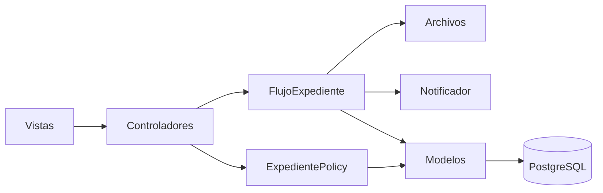
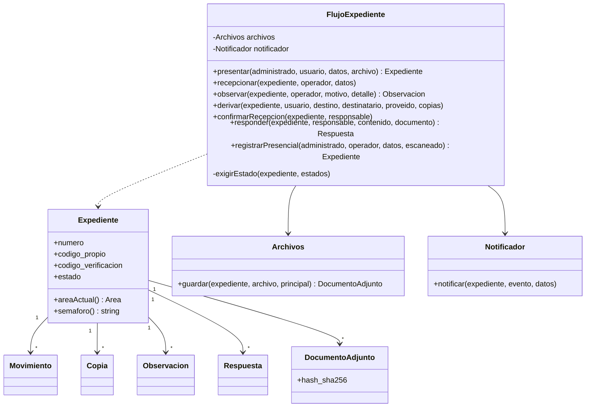
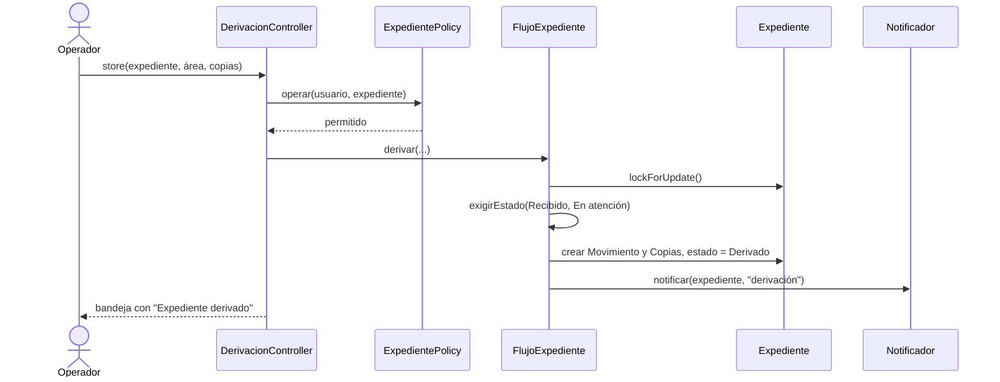

# Diseño interno

## 1. Objetivo

Describir cómo está organizado por dentro el código del sistema y cómo se ejecuta un caso de uso.

## 2. Estructura de carpetas

```text
app/
├── Exceptions/ReglaNegocio.php        # error de regla de negocio (vuelve con aviso)
├── Http/
│   ├── Controllers/                   # capa de control
│   │   ├── Admin/                     # usuarios, áreas, tipos de documento, auditoría
│   │   ├── Auth/SesionController.php  # CU02
│   │   ├── TramiteExternoController.php  # CU05, CU06, CU07
│   │   ├── MesaPartesController.php   # CU08, CU09, CU17
│   │   ├── DerivacionController.php   # CU10
│   │   ├── AreaController.php         # CU11, CU12, CU13
│   │   ├── VerificacionController.php # CU19
│   │   ├── PdfController.php          # RF26 (PDF con QR)
│   │   └── ...                        # Busqueda, Reporte, Pendientes, Copia, Documento
│   └── Middleware/VerificarRol.php
├── Models/                            # capa de datos (Eloquent)
├── Notifications/AvisoExpediente.php  # correo
├── Policies/ExpedientePolicy.php      # quién ve y quién opera un expediente
├── Services/                          # capa de servicios
│   ├── FlujoExpediente.php
│   ├── Notificador.php
│   ├── Archivos.php
│   └── Verificacion.php
└── Support/                           # Menu, Captcha, AreasDerivacion
config/plazos.php                      # días del semáforo
database/migrations/                   # tablas de PostgreSQL
resources/views/                       # capa de presentación (Blade)
routes/web.php                         # rutas públicas y del personal (subdominio)
specs/                                 # una especificación por caso de uso (SDD)
tests/Feature/                         # pruebas automáticas por caso de uso
```

## 3. Organización por capas

### 3.1. Presentación
`resources/views`: `externo/` (portal público), `mesa/`, `area/`, `admin/`, `verificar/`, `pdf/` y `partials/` (estado, semáforo, verificación).

### 3.2. Control
Controladores delgados: validan con `$request->validate()`, autorizan con `Gate::authorize()` y llaman al servicio.

### 3.3. Servicios
`FlujoExpediente` concentra las reglas: estados permitidos (`exigirEstado`), bloqueo de fila, movimientos y notificaciones.

### 3.4. Datos
Modelos con relaciones (`hasMany`, `belongsTo`) y métodos de dominio como `Expediente::areaActual()`, `burbujas()` y `semaforo()`.

## 4. Regla de dependencias entre capas

### 4.1. Diagrama de dependencias



## 5. Organización funcional

| Caso de uso | Controlador → método | Servicio → método |
|---|---|---|
| CU05 Presentar trámite virtual | `TramiteExternoController@store` | `FlujoExpediente::presentar` |
| CU06 Subsanar observación | `TramiteExternoController@subsanar` | `FlujoExpediente::subsanar` |
| CU08 Recepcionar expediente | `MesaPartesController@recepcionar` | `FlujoExpediente::recepcionar` |
| CU09 Observar expediente | `MesaPartesController@observar` | `FlujoExpediente::observar` |
| CU10 Derivar expediente | `DerivacionController@store` | `FlujoExpediente::derivar` |
| CU11 Confirmar recepción | `AreaController@confirmar` | `FlujoExpediente::confirmarRecepcion` |
| CU12 Actualizar estado | `AreaController@avance` | `FlujoExpediente::registrarAvance` |
| CU13 Registrar respuesta | `AreaController@responder` | `FlujoExpediente::responder` |
| CU17 Registro presencial | `MesaPartesController@registrarPresencial` | `FlujoExpediente::registrarPresencial` |
| CU19 Verificar documento | `VerificacionController@show` | `Verificacion::buscar` |

## 6. Diagrama de clases del flujo del expediente

### 6.1. Diagrama de clases



## 7. Flujo de ejecución de un caso de uso (CU10 Derivar)

### 7.1. Descripción del flujo

1. El operador elige el área destino y, si quiere, áreas con copia.
2. `DerivacionController` valida los datos y comprueba con `ExpedientePolicy::operar` que el expediente está en su área.
3. `FlujoExpediente::derivar` abre una transacción, bloquea la fila del expediente y revisa que esté Recibido o En atención.
4. Revisa las reglas: no derivar a su propia área, áreas activas, sin copia a Mesa de Partes ni al destino.
5. Crea el movimiento, las copias y cambia el estado a Derivado.
6. Al terminar la transacción, el Notificador envía el correo al administrado.
7. El controlador vuelve a la bandeja con un mensaje de éxito.

### 7.2. Diagrama de secuencia



## 8. Criterios de diseño

- Un método de servicio por caso de uso.
- Las reglas de negocio lanzan `ReglaNegocio`; el usuario ve un aviso y no un error.
- Las operaciones que cambian un expediente van en transacción con bloqueo de fila.
- Código nuevo en archivos nuevos cuando es posible, para no chocar entre ramas del equipo.

## 9. Consideraciones

El diseño corresponde a los diagramas de clases y de secuencia del análisis ICONIX del proyecto.
