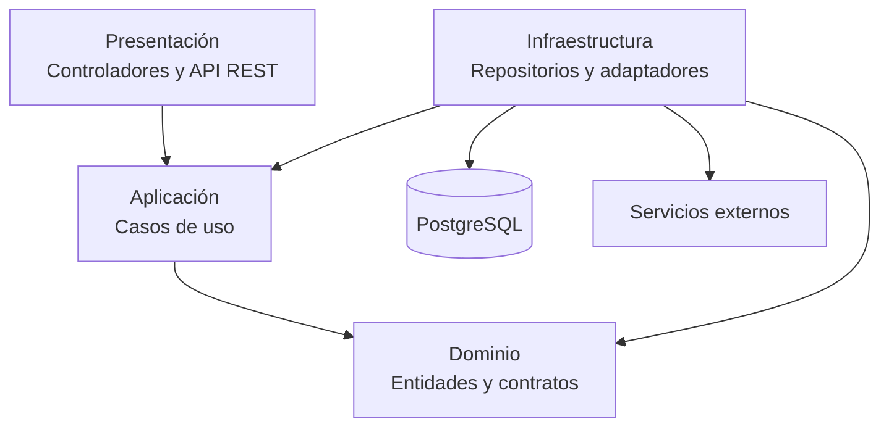
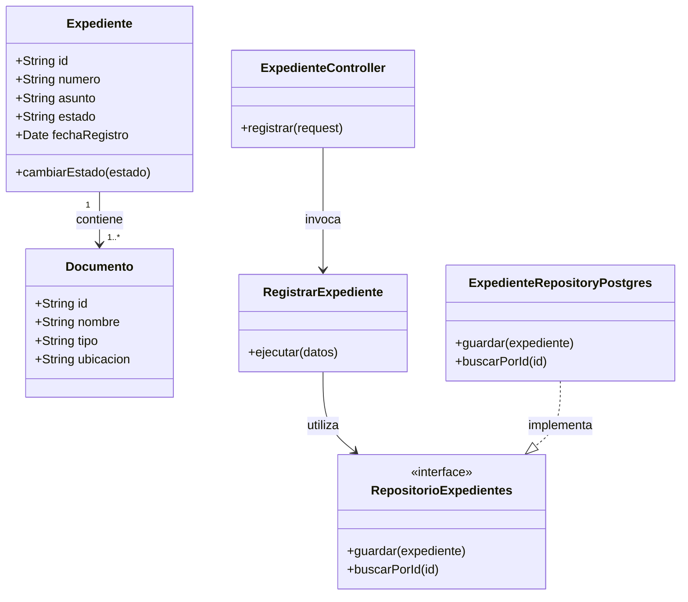
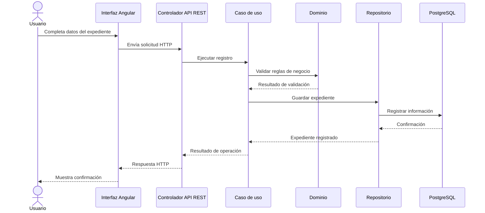

# Diseño interno de módulos

## 1. Objetivo

Describir la organización interna de los módulos del sistema de Mesa de Partes Virtual del IESTP Manuel Antonio Hierro Pozo – Ayacucho, aplicando el enfoque de Clean Architecture dentro de un estilo arquitectónico de monolito modular.

Este diseño establece la distribución de responsabilidades entre las capas de dominio, aplicación, infraestructura y presentación. También define las relaciones entre los componentes y las reglas que deben respetarse para mantener una estructura organizada, modular y fácil de mantener.

## 2. Estructura de carpetas

El sistema se organizará mediante módulos funcionales independientes. Cada módulo tendrá una estructura interna basada en Clean Architecture.

La siguiente estructura representa una propuesta de organización para el backend:

```text
src/
└── modules/
    ├── usuarios-seguridad/
    │   ├── dominio/
    │   ├── aplicacion/
    │   ├── infraestructura/
    │   ├── presentacion/
    │   └── index.ts
    │
    ├── tramites/
    │   ├── dominio/
    │   ├── aplicacion/
    │   ├── infraestructura/
    │   ├── presentacion/
    │   └── index.ts
    │
    ├── expedientes/
    │   ├── dominio/
    │   ├── aplicacion/
    │   ├── infraestructura/
    │   ├── presentacion/
    │   └── index.ts
    │
    ├── documentos/
    │   ├── dominio/
    │   ├── aplicacion/
    │   ├── infraestructura/
    │   ├── presentacion/
    │   └── index.ts
    │
    ├── derivaciones/
    │   ├── dominio/
    │   ├── aplicacion/
    │   ├── infraestructura/
    │   ├── presentacion/
    │   └── index.ts
    │
    ├── seguimiento/
    │   ├── dominio/
    │   ├── aplicacion/
    │   ├── infraestructura/
    │   ├── presentacion/
    │   └── index.ts
    │
    ├── notificaciones/
    │   ├── dominio/
    │   ├── aplicacion/
    │   ├── infraestructura/
    │   ├── presentacion/
    │   └── index.ts
    │
    └── reportes-auditoria/
        ├── dominio/
        ├── aplicacion/
        ├── infraestructura/
        ├── presentacion/
        └── index.ts
```

La estructura es una propuesta lógica para organizar el backend. Los nombres y archivos concretos se definirán durante la implementación.

## 3. Organización por capas

Cada módulo estará compuesto por cuatro capas, cada una con responsabilidades específicas.

### 3.1. Dominio

Contiene las entidades, objetos de valor, reglas de negocio y contratos que representan los conceptos principales del sistema.

Ejemplos de elementos:

- Usuario.
- Trámite.
- Expediente.
- Documento.
- Área responsable.
- Estado del expediente.
- Contratos de repositorios y servicios.

Esta capa no debe depender de tecnologías externas, frameworks, bases de datos ni interfaces de usuario.

### 3.2. Aplicación

Contiene los casos de uso que coordinan las operaciones del sistema. Utiliza los elementos del dominio para ejecutar las acciones solicitadas.

Ejemplos de casos de uso:

- Registrar solicitud.
- Registrar expediente.
- Derivar expediente.
- Consultar estado del trámite.
- Registrar documentos.
- Generar reporte.

Esta capa define qué operaciones puede realizar el sistema y coordina su ejecución mediante los contratos establecidos por el dominio.

### 3.3. Infraestructura

Contiene las implementaciones técnicas necesarias para conectar el sistema con recursos externos.

Ejemplos:

- Repositorios para acceder a PostgreSQL.
- Adaptadores para almacenar documentos.
- Servicios de envío de notificaciones.
- Implementaciones de autenticación.
- Mecanismos de registro de auditoría.

Esta capa implementa los contratos definidos por las capas internas, sin trasladar las reglas del negocio a los mecanismos tecnológicos.

### 3.4. Presentación

Contiene los mecanismos mediante los cuales los usuarios y otros componentes interactúan con el sistema.

En el backend comprende:

- Controladores.
- Rutas de la API REST.
- Validación de solicitudes HTTP.
- Respuestas y códigos de estado HTTP.

El frontend Angular constituye la interfaz visual desde la cual los usuarios realizan las operaciones del sistema.

## 4. Regla de dependencias entre capas

Las dependencias deben dirigirse hacia las capas internas, respetando el principio de inversión de dependencias de Clean Architecture.

Las reglas principales son:

1. El dominio no depende de ninguna otra capa.
2. La aplicación depende del dominio.
3. La infraestructura implementa los contratos definidos por las capas internas.
4. La presentación se comunica con los casos de uso de la aplicación.
5. Las dependencias externas se configuran desde el punto de composición del sistema.

### 4.1. Diagrama de dependencias



La infraestructura proporciona las implementaciones necesarias para que los casos de uso puedan acceder a los recursos externos mediante contratos. El diagrama representa las relaciones principales, no una autorización para que las capas internas dependan directamente de tecnologías externas.

## 5. Organización funcional de los módulos

El sistema estará dividido en los siguientes módulos funcionales:

| Módulo | Funciones principales |
|---|---|
| Usuarios y seguridad | Autenticación, gestión de usuarios, roles y permisos. |
| Trámites | Registro y consulta de solicitudes. |
| Expedientes | Creación, seguimiento y control de estados. |
| Documentos | Gestión de archivos y metadatos. |
| Derivaciones | Asignación de expedientes a áreas y responsables. |
| Seguimiento | Consulta del historial y estado de los trámites. |
| Notificaciones | Comunicación de cambios relevantes. |
| Reportes y auditoría | Consultas, informes e historial de acciones relevantes. |

Cada módulo tendrá responsabilidades delimitadas y expondrá únicamente las operaciones necesarias para la interacción con los demás módulos.

## 6. Diagrama de clases de un módulo

Como ejemplo, se presenta el diseño interno del módulo de Expedientes. Este módulo permite representar la información principal de un expediente y coordinar su registro mediante un caso de uso.

### 6.1. Diagrama de clases



El diagrama muestra las principales responsabilidades y relaciones entre los componentes del módulo. La interfaz del repositorio permite mantener el caso de uso independiente de la tecnología utilizada para almacenar los expedientes.

## 7. Flujo de ejecución de un caso de uso

Se toma como ejemplo el registro de un expediente.

### 7.1. Descripción del flujo

1. El usuario autorizado completa el formulario de registro desde la interfaz.
2. La presentación envía los datos a través de la API REST.
3. El controlador recibe la solicitud y ejecuta el caso de uso correspondiente.
4. La aplicación valida los datos y coordina la operación.
5. El dominio aplica las reglas de negocio correspondientes.
6. La infraestructura utiliza el repositorio para almacenar el expediente en PostgreSQL.
7. El sistema devuelve una respuesta con el resultado de la operación.

### 7.2. Diagrama de secuencia



## 8. Referencia de organización del código

A continuación, se presentan ejemplos conceptuales de cómo podrían organizarse los componentes del módulo de Expedientes.

Los fragmentos son ilustrativos y representan una propuesta de implementación, no código que necesariamente se encuentre desarrollado en el prototipo actual.

### 8.1. Dominio

Archivo: `expediente.ts`

```typescript
export class Expediente {
  constructor(
    public readonly id: string,
    public readonly numero: string,
    public readonly asunto: string,
    private estado: string
  ) {}

  cambiarEstado(nuevoEstado: string): void {
    this.estado = nuevoEstado;
  }

  obtenerEstado(): string {
    return this.estado;
  }
}
```

El dominio representa el expediente y contiene las operaciones relacionadas con sus reglas de negocio.

### 8.2. Aplicación

Archivo: `registrar-expediente.use-case.ts`

```typescript
import { Expediente } from "../dominio/expediente";
import { RepositorioExpedientes } from "../dominio/repositorio-expedientes";

export class RegistrarExpediente {
  constructor(
    private readonly repositorio: RepositorioExpedientes
  ) {}

  async ejecutar(expediente: Expediente): Promise<void> {
    await this.repositorio.guardar(expediente);
  }
}
```

El caso de uso coordina el registro del expediente utilizando el contrato del repositorio.

### 8.3. Infraestructura

Archivo: `repositorio-expedientes.postgres.ts`

```typescript
import { Expediente } from "../dominio/expediente";
import { RepositorioExpedientes } from "../dominio/repositorio-expedientes";

export class RepositorioExpedientesPostgres
  implements RepositorioExpedientes {

  async guardar(expediente: Expediente): Promise<void> {
    // Implementación pendiente de persistencia en PostgreSQL.
  }
}
```

Esta clase representa la implementación técnica del repositorio. La conexión y las consultas reales a PostgreSQL se incorporarán durante el desarrollo.

### 8.4. Presentación

Archivo: `expediente.controller.ts`

```typescript
export class ExpedienteController {
  constructor(
    private readonly registrarExpediente: RegistrarExpediente
  ) {}

  async registrar(request: any) {
    await this.registrarExpediente.ejecutar(request.body);

    return {
      mensaje: "Expediente registrado correctamente"
    };
  }
}
```

El controlador recibe la solicitud y delega la operación al caso de uso. El ejemplo es ilustrativo y deberá adaptarse al framework y a los mecanismos de validación que se definan para el backend.

## 9. Criterios de diseño

Para mantener una arquitectura organizada y facilitar el mantenimiento del sistema, se establecen los siguientes criterios:

- Mantener una responsabilidad clara por módulo.
- Evitar dependencias innecesarias entre módulos.
- Mantener las reglas del negocio independientes de la tecnología.
- Utilizar contratos para acceder a mecanismos externos.
- Centralizar la configuración de dependencias.
- Registrar las operaciones relevantes para asegurar la trazabilidad.
- Evitar que un módulo acceda directamente a los componentes internos de otro módulo.

## 10. Consideraciones

Esta organización representa una propuesta de diseño interno para el sistema de Mesa de Partes Virtual. La estructura de carpetas, clases, interfaces y componentes se concretará durante el desarrollo.

Los diagramas y fragmentos de código describen la organización prevista y no significan que todos los módulos o mecanismos de persistencia se encuentren implementados actualmente.