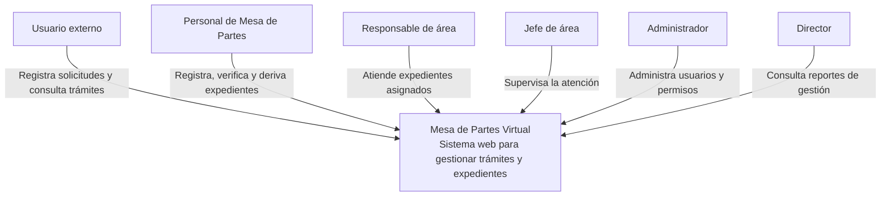

# C4 Nivel 1: Diagrama de Contexto del Sistema

## 1. Objetivo

Representar el sistema de Mesa de Partes Virtual y su relación con los usuarios y los sistemas externos.

## 2. Sistema

**Mesa de Partes Virtual:** sistema propuesto para registrar, derivar, atender y realizar el seguimiento de trámites y expedientes del IESTP Manuel Antonio Hierro Pozo – Ayacucho.

## 3. Actores principales

- **Usuario externo:** registra solicitudes, adjunta documentos y consulta el estado de sus trámites.
- **Personal de Mesa de Partes:** recibe y verifica documentos, registra expedientes y realiza derivaciones.
- **Responsable de área:** recibe expedientes asignados y registra su atención.
- **Jefe de área:** supervisa la atención de expedientes de su área.
- **Administrador:** gestiona usuarios, roles y parámetros del sistema.
- **Director:** consulta reportes e información de gestión.

## 4. Diagrama de contexto

## 5. Alcance

El sistema comprende el registro de solicitudes, la gestión de expedientes y documentos, las derivaciones, el seguimiento, las notificaciones y los reportes.

Las integraciones con otros sistemas institucionales se consideran futuras y deberán definirse según los requisitos correspondientes.