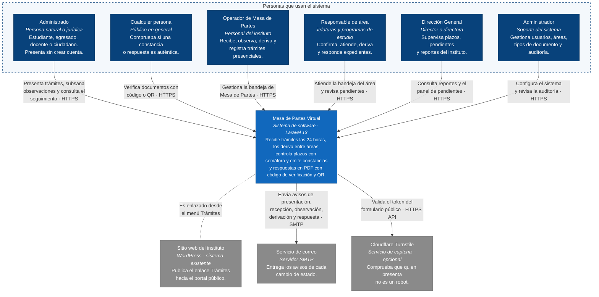

# C4 Nivel 1: Diagrama de contexto del sistema

## 1. Objetivo

Mostrar el sistema Mesa de Partes Virtual, quiénes lo usan y con qué sistemas externos se relaciona.

## 2. Sistema

**Mesa de Partes Virtual:** sistema web del IESTP Manuel Antonio Hierro Pozo para presentar, recepcionar, derivar, atender, seguir y verificar trámites documentarios.

## 3. Actores y sistemas externos

- **Administrado:** presenta su trámite sin cuenta y lo consulta con N.° y documento de identidad.
- **Cualquier persona:** verifica una constancia o respuesta con el código o el QR.
- **Operador de Mesa de Partes:** recepciona, observa, deriva y registra lo presencial.
- **Responsable de área:** confirma, atiende y responde.
- **Administrador:** gestiona usuarios, áreas y tipos de documento.
- **Dirección General:** revisa reportes y pendientes.
- **Servicio de correo (externo):** entrega las notificaciones.
- **Sitio web del instituto (externo):** enlaza al portal desde el menú "Trámites".
- **Cloudflare Turnstile (externo, opcional):** captcha del formulario público; si no se configura, el sistema usa su propio captcha.

## 4. Diagrama de contexto

**Leyenda de colores:** azul oscuro = personas · azul = sistema, contenedores o servicios propios · celeste = controladores y entrada · naranja = autorización · amarillo = datos · gris = sistemas externos. Las líneas punteadas son relaciones opcionales o de apoyo.

## 5. Alcance

Fuera del sistema: RENIEC, pagos, Firma Perú y sistemas del MINEDU.
