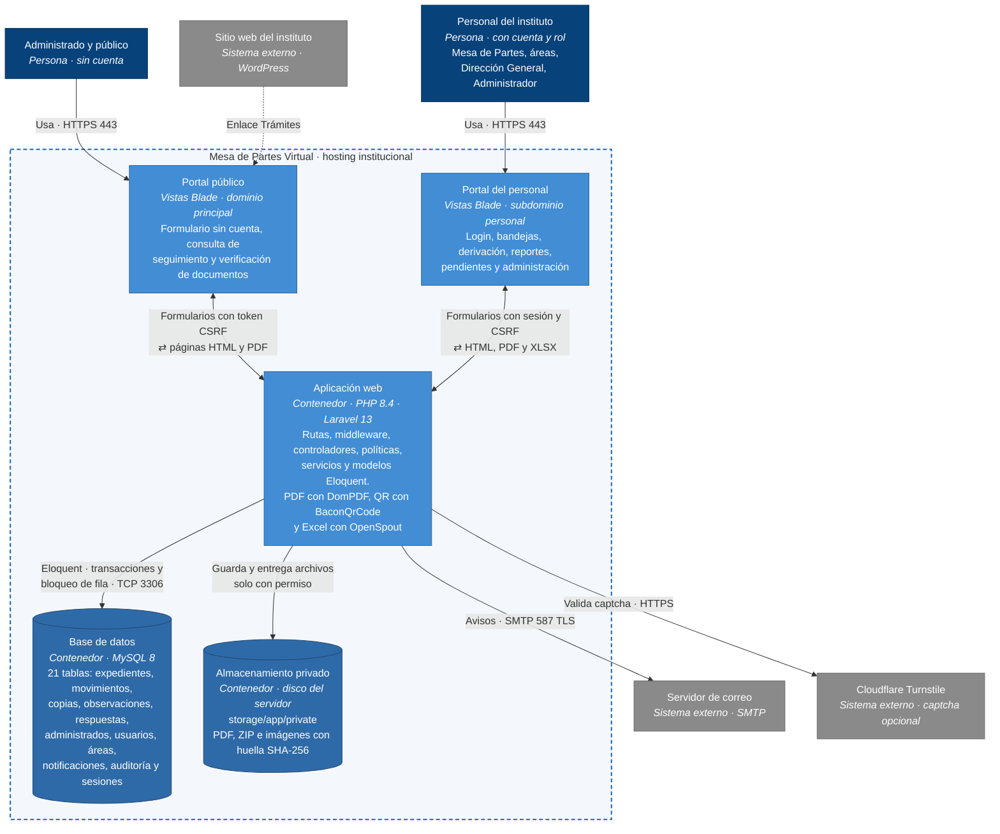

# C4 Nivel 2: Diagrama de contenedores

## 1. Objetivo

Mostrar las piezas que se ejecutan en el hosting.

## 2. Contenedores

| Contenedor | Tecnología | Responsabilidad |
|---|---|---|
| Navegador | Chrome, Edge, Firefox (PC o celular) | Muestra el HTML que genera el servidor. |
| Aplicación web | PHP 8.4+, Laravel 13, Blade | Portal público, portal del personal (subdominio), reglas de negocio y PDF. |
| Base de datos | MySQL 8 | Expedientes, movimientos, usuarios, áreas, sesiones, caché y auditoría. |
| Almacenamiento de archivos | Disco privado del servidor (`storage/app/private`) | PDF y ZIP de los trámites, escaneos y respuestas. |
| Servidor de correo | SMTP externo | Envío de notificaciones. |

## 3. Diagrama de contenedores

**Leyenda de colores:** azul oscuro = personas · azul = sistema, contenedores o servicios propios · celeste = controladores y entrada · naranja = autorización · amarillo = datos · gris = sistemas externos. Las líneas punteadas son relaciones opcionales o de apoyo.

## 4. Comunicación entre contenedores

- Navegador ↔ aplicación: HTTPS, formularios y páginas HTML (sin API REST).
- Aplicación ↔ base de datos: conexión `mysql` de Laravel.
- Aplicación ↔ archivos: disco local privado; descarga solo con permiso.
- Aplicación → correo: SMTP configurado en `.env`.
- Aplicación → Cloudflare Turnstile: HTTPS, solo si están las claves `TURNSTILE_*` en `.env`; si no, usa su captcha propio.

## 5. Consideraciones

Todo corre en un solo hosting. El subdominio del personal apunta a la misma aplicación; Laravel separa las rutas según el dominio (`APP_STAFF_DOMAIN`).
