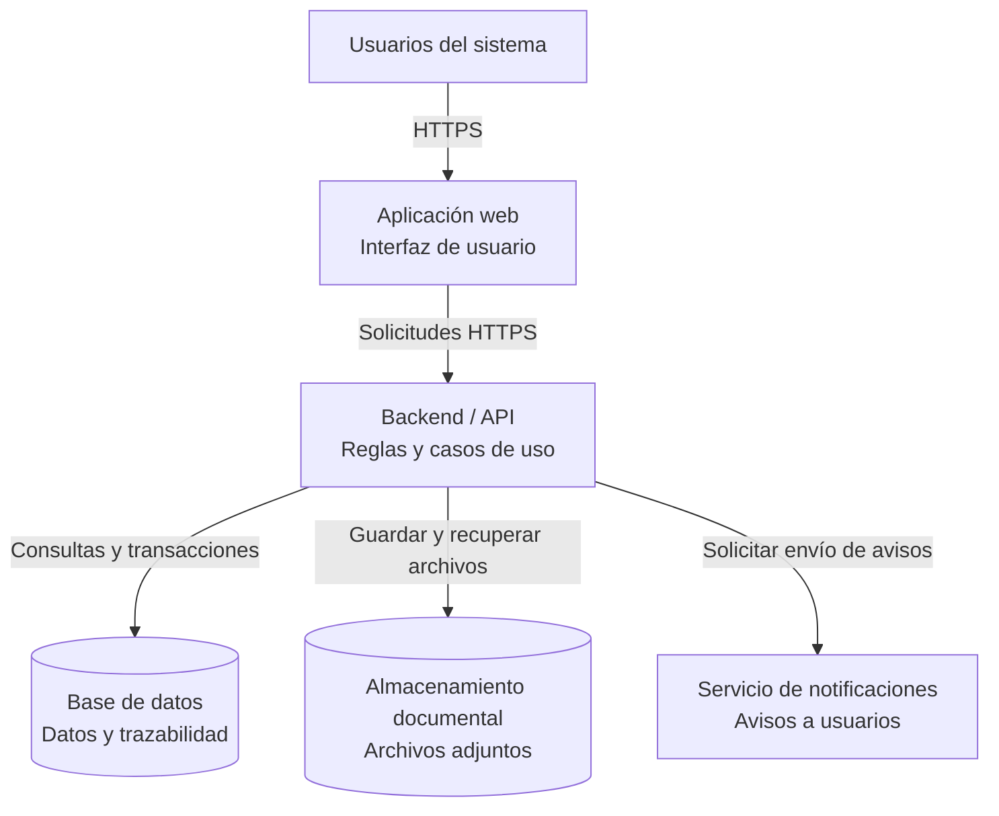

# C4 Nivel 2: Diagrama de Contenedores

## 1. Objetivo

Representar los principales contenedores tecnológicos del sistema y mostrar cómo se comunican entre sí.

En C4, un contenedor es una aplicación o un almacén de datos ejecutable; no significa necesariamente un contenedor Docker.

## 2. Contenedores propuestos

| Contenedor | Responsabilidad |
|---|---|
| Aplicación web | Presentar las interfaces para usuarios externos y personal institucional. |
| Backend / API | Procesar las solicitudes y ejecutar los casos de uso del sistema. |
| Base de datos | Almacenar usuarios, trámites, expedientes, estados e historial. |
| Almacenamiento documental | Conservar los archivos adjuntos de los expedientes. |
| Servicio de notificaciones | Facilitar el envío de avisos sobre cambios en los trámites. |

## 3. Diagrama de contenedores

## 4. Comunicación entre contenedores

1. Los usuarios acceden a la aplicación web.
2. La aplicación web envía solicitudes al backend.
3. El backend ejecuta las operaciones y consulta o actualiza la base de datos.
4. Los documentos se gestionan mediante el almacenamiento documental.
5. El backend solicita notificaciones cuando corresponde.

## 5. Consideraciones

Estos contenedores representan una propuesta lógica inicial. Las tecnologías específicas, el mecanismo de almacenamiento y el proveedor de notificaciones se definirán posteriormente.

La aplicación web, el backend y los almacenes de datos no implican necesariamente despliegues independientes; su organización final deberá mantener coherencia con el monolito modular propuesto.