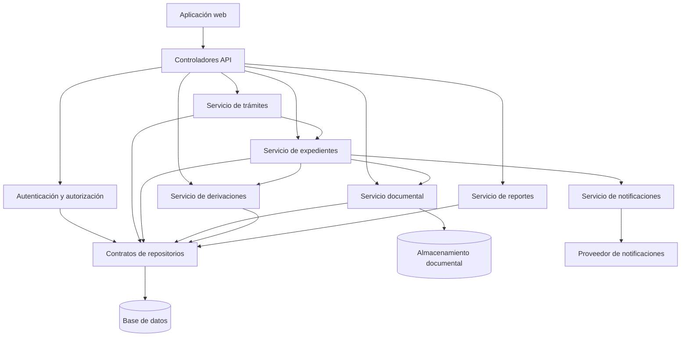

# C4 Nivel 3: Diagrama de Componentes

## 1. Objetivo

Mostrar los principales componentes internos del backend de Mesa de Partes Virtual y sus responsabilidades.

## 2. Componentes principales

| Componente | Responsabilidad |
|---|---|
| Controladores | Recibir las solicitudes de la aplicación web y devolver respuestas. |
| Autenticación y autorización | Verificar la identidad y los permisos del usuario. |
| Servicio de trámites | Coordinar el registro y la consulta de solicitudes. |
| Servicio de expedientes | Gestionar la creación, los estados y el seguimiento de expedientes. |
| Servicio documental | Coordinar el registro y la consulta de documentos. |
| Servicio de derivaciones | Gestionar la asignación de expedientes a áreas y responsables. |
| Servicio de notificaciones | Coordinar los avisos relacionados con los trámites y comunicarse con el proveedor de notificaciones. |
| Servicio de reportes | Preparar consultas e informes de gestión. |
| Repositorios | Definir el acceso a los datos almacenados. |

## 3. Diagrama de componentes

## 4. Descripción de las interacciones

1. Los controladores reciben las solicitudes de la aplicación web.
2. Los componentes de seguridad verifican la identidad y los permisos.
3. Los servicios ejecutan los casos de uso correspondientes.
4. Los contratos de repositorios permiten acceder a los datos sin acoplar la lógica del negocio a una base de datos concreta.
5. El servicio documental gestiona los archivos asociados a los expedientes.
6. Las notificaciones se coordinan cuando se producen eventos relevantes.

## 5. Consideraciones

Este diagrama representa una propuesta lógica del backend. Los componentes no son necesariamente servicios independientes: pueden implementarse como módulos dentro del monolito modular y organizarse internamente siguiendo Clean Architecture.