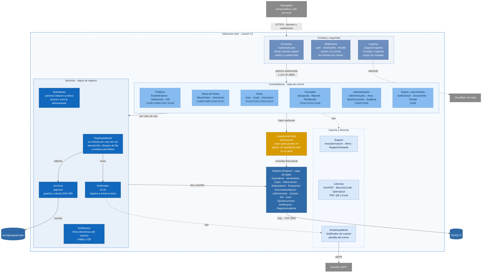

# C4 Nivel 3: Diagrama de componentes de la aplicación web

## 1. Objetivo

Mostrar los componentes dentro de la aplicación Laravel.

## 2. Componentes

Ver la tabla completa en [componentes arquitectónicos](../02-arquitectura-software/componentes-arquitectonicos.md).

## 3. Diagrama de componentes

**Leyenda de colores:** azul oscuro = personas · azul = sistema, contenedores o servicios propios · celeste = controladores y entrada · naranja = autorización · amarillo = datos · gris = sistemas externos. Las líneas punteadas son relaciones opcionales o de apoyo.

## 4. Descripción de las interacciones

1. Las rutas aplican el middleware y envían la petición al controlador.
2. Los controladores del personal consultan `ExpedientePolicy` antes de operar.
3. Todas las operaciones sobre un expediente pasan por `FlujoExpediente`.
4. La verificación pública usa `Verificacion`, que solo lee datos.
5. Búsquedas, reportes y pendientes consultan los modelos directamente (solo lectura).

## 5. Consideraciones

Los componentes son clases dentro de una sola aplicación.
