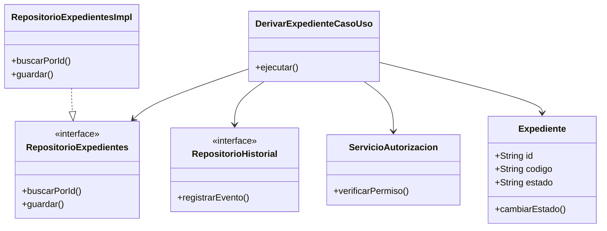

# C4 Nivel 4: Diagrama de Código

## 1. Objetivo

Representar una posible organización interna del código para el caso de uso de derivación de expedientes, siguiendo el enfoque de Clean Architecture.

## 2. Elementos propuestos

| Elemento | Responsabilidad |
|---|---|
| Expediente | Representar los datos y el estado del expediente. |
| DerivarExpedienteCasoUso | Coordinar la operación de derivación. |
| RepositorioExpedientes | Definir las operaciones para consultar y guardar expedientes. |
| RepositorioHistorial | Definir las operaciones para registrar las acciones realizadas. |
| ServicioAutorizacion | Verificar que el usuario tenga permiso para derivar el expediente. |
| RepositorioExpedientesImpl | Implementar el acceso a los datos de expedientes. |

## 3. Diagrama de código

## 4. Descripción del flujo

1. El caso de uso recibe la solicitud de derivación.
2. El servicio de autorización verifica los permisos.
3. El caso de uso obtiene el expediente mediante el contrato del repositorio.
4. Se valida la operación y se actualiza el estado o la asignación según las reglas del negocio.
5. Se guarda el expediente y se registra el evento en el historial.

## 5. Consideraciones

Este diagrama es un modelo de código propuesto, no una representación de clases ya implementadas. Las clases, métodos y contratos definitivos se ajustarán durante la implementación del sistema.