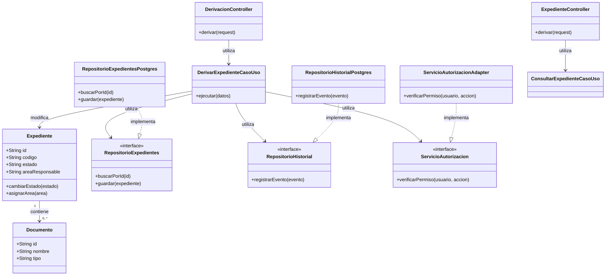
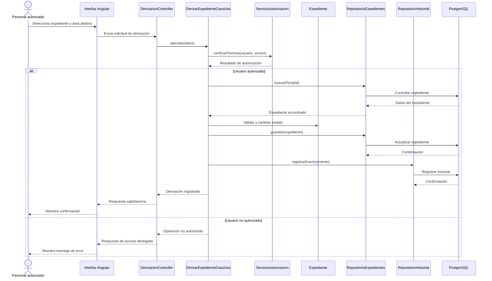

# C4 Nivel 4: Diagrama de Código

> **Proyecto:** Sistema de Mesa de Partes Virtual del IESTP Manuel Antonio Hierro Pozo – Ayacucho  
> **Módulo detallado:** Expedientes y Derivaciones  
> **Modelo:** C4 – Nivel 4 de 4  
> **Notación:** UML  
> **Versión:** 1.0

---

## 1. Objetivo

Mostrar cómo se organiza internamente el código de los módulos de Expedientes y Derivaciones, identificando sus clases, interfaces, responsabilidades y relaciones.

Se detalla el flujo de **Derivar expediente**, que permite asignar un expediente a un área responsable, verificar las autorizaciones correspondientes, actualizar su información y registrar la operación en el historial.

| Aspecto | Descripción |
|---|---|
| Pregunta que responde | ¿Qué clases existen dentro de los módulos y cómo se relacionan? |
| Audiencia | Desarrolladores del sistema. |
| Notación | UML: diagrama de clases y diagrama de secuencia. |
| Módulos detallados | Expedientes y Derivaciones, por su participación en el proceso de asignación y seguimiento de expedientes. |
| Nivel anterior | Diagrama de componentes del sistema (C4 – Nivel 3). |

## 2. Diagrama de clases

El diagrama representa la organización interna de los componentes que participan en el proceso de derivación de expedientes, aplicando las capas de Clean Architecture.

### 2.1. Capas de Clean Architecture

| Capa | Contiene | Responsabilidad |
|---|---|---|
| **Presentación** | Controladores y rutas de la API REST. | Recibe las solicitudes HTTP y comunica los resultados al cliente. |
| **Aplicación** | Casos de uso. | Coordina las operaciones y ejecuta el proceso de derivación. |
| **Dominio** | Entidades, reglas de negocio e interfaces. | Define las reglas y contratos relacionados con los expedientes y las derivaciones. |
| **Infraestructura** | Repositorios y adaptadores. | Implementa los contratos para acceder a PostgreSQL y otros servicios externos. |

**Regla de dependencia:** las capas internas no deben depender de las tecnologías externas. La aplicación utiliza contratos y la infraestructura proporciona sus implementaciones.

### 2.2. Clases del módulo Expedientes

| Clase | Tipo | Capa | Responsabilidad |
|---|---|---|---|
| `ExpedienteController` | Controlador | Presentación | Recibe las solicitudes relacionadas con los expedientes. |
| `ConsultarExpedienteCasoUso` | Caso de uso | Aplicación | Coordina la consulta de información de un expediente. |
| `Expediente` | Entidad | Dominio | Representa el expediente y controla sus estados. |
| `Documento` | Entidad | Dominio | Representa los documentos asociados al expediente. |
| `RepositorioExpedientes` | Interfaz | Dominio | Define las operaciones para buscar y guardar expedientes. |
| `RepositorioExpedientesPostgres` | Repositorio | Infraestructura | Implementa el acceso a los expedientes almacenados en PostgreSQL. |

### 2.3. Clases del módulo Derivaciones

| Clase | Tipo | Capa | Responsabilidad |
|---|---|---|---|
| `DerivacionController` | Controlador | Presentación | Recibe las solicitudes para derivar expedientes. |
| `DerivarExpedienteCasoUso` | Caso de uso | Aplicación | Coordina la validación, asignación y registro de la derivación. |
| `ServicioAutorizacion` | Interfaz | Dominio | Define el contrato para verificar los permisos necesarios. |
| `RepositorioHistorial` | Interfaz | Dominio | Define las operaciones para registrar los eventos del expediente. |
| `RepositorioHistorialPostgres` | Repositorio | Infraestructura | Implementa el registro de eventos en PostgreSQL. |
| `ServicioAutorizacionAdapter` | Adaptador | Infraestructura | Implementa la verificación de permisos mediante el mecanismo de seguridad definido. |

### 2.4. Diagrama UML de clases

### 2.5. Notación UML utilizada

| Símbolo | Significado | Ejemplo |
|---|---|---|
| Línea continua con flecha abierta | Asociación o relación de uso entre clases. | `DerivarExpedienteCasoUso` → `RepositorioExpedientes`. |
| Línea discontinua con flecha abierta | Dependencia entre componentes. | Un caso de uso utiliza una entidad. |
| Línea discontinua con triángulo hueco | Realización: una clase implementa una interfaz. | `RepositorioExpedientesPostgres` ▷ `RepositorioExpedientes`. |
| Rombo relleno | Composición: una parte depende del ciclo de vida del conjunto. | Relación de composición cuando corresponda entre un expediente y sus elementos internos. |
| `<<interface>>` | Identifica una interfaz o contrato. | `RepositorioExpedientes`. |
| `+` y `-` | Indican miembros públicos y privados. | `+ cambiarEstado()` y `- estado`. |

## 3. Diagrama de secuencia: derivar expediente

Se representa la interacción entre el usuario autorizado, la interfaz, la API REST, el caso de uso, las reglas del dominio y los mecanismos de persistencia.

### 3.1. Descripción del flujo

| Paso | Origen → destino | Acción |
|---|---|---|
| 1 | Personal autorizado → Interfaz Angular | Selecciona el expediente e indica el área de destino. |
| 2 | Interfaz Angular → `DerivacionController` | Envía la solicitud de derivación mediante HTTP. |
| 3 | `DerivacionController` → `DerivarExpedienteCasoUso` | Ejecuta el caso de uso. |
| 4 | `DerivarExpedienteCasoUso` → `ServicioAutorizacion` | Verifica los permisos del usuario. |
| 5 | `DerivarExpedienteCasoUso` → `RepositorioExpedientes` | Busca el expediente correspondiente. |
| 6 | `DerivarExpedienteCasoUso` → `Expediente` | Valida las reglas y actualiza el área responsable y el estado. |
| 7 | `DerivarExpedienteCasoUso` → `RepositorioExpedientes` | Solicita guardar los cambios. |
| 8 | `DerivarExpedienteCasoUso` → `RepositorioHistorial` | Registra la acción de derivación. |
| 9 | Repositorios → PostgreSQL | Persisten la información correspondiente. |
| 10 | `DerivarExpedienteCasoUso` → `DerivacionController` | Devuelve el resultado de la operación. |
| 11 | `DerivacionController` → Interfaz Angular | Responde con el resultado de la solicitud. |
| 12 | Interfaz Angular → Usuario | Muestra la confirmación de la derivación. |

### 3.2. Diagrama de secuencia UML

## 4. Patrones y principios que se identifican en este nivel

| Elemento del diseño | Patrón o principio | Aplicación en el sistema |
|---|---|---|
| `RepositorioExpedientes` y `RepositorioExpedientesPostgres` | **Repository** | Separa las operaciones de persistencia de las reglas del negocio. |
| `ServicioAutorizacion` y `ServicioAutorizacionAdapter` | **Adapter** | Permite implementar el mecanismo de autorización mediante un contrato. |
| `DerivarExpedienteCasoUso` recibe contratos | **Inversión de dependencias (DIP)** | El caso de uso no depende directamente de implementaciones concretas. |
| Controladores, casos de uso y entidades separados | **Responsabilidad única (SRP)** | Cada componente mantiene una función específica. |
| Contratos de repositorios y servicios | **Segregación de interfaces (ISP)** | Cada contrato expone las operaciones necesarias para una responsabilidad. |
| Comunicación mediante operaciones públicas de los módulos | **Monolito modular** | Se evita acceder directamente a los detalles internos de otros módulos. |

## 5. Consideraciones

Este documento representa una propuesta de diseño de código para los módulos de Expedientes y Derivaciones del sistema de Mesa de Partes Virtual.

Los diagramas UML muestran las clases, interfaces y relaciones previstas para organizar la implementación mediante Clean Architecture.

Los nombres de clases y métodos son referenciales y podrán ajustarse durante el desarrollo. La implementación definitiva deberá respetar las responsabilidades de cada capa, los contratos establecidos y las reglas de negocio del sistema.