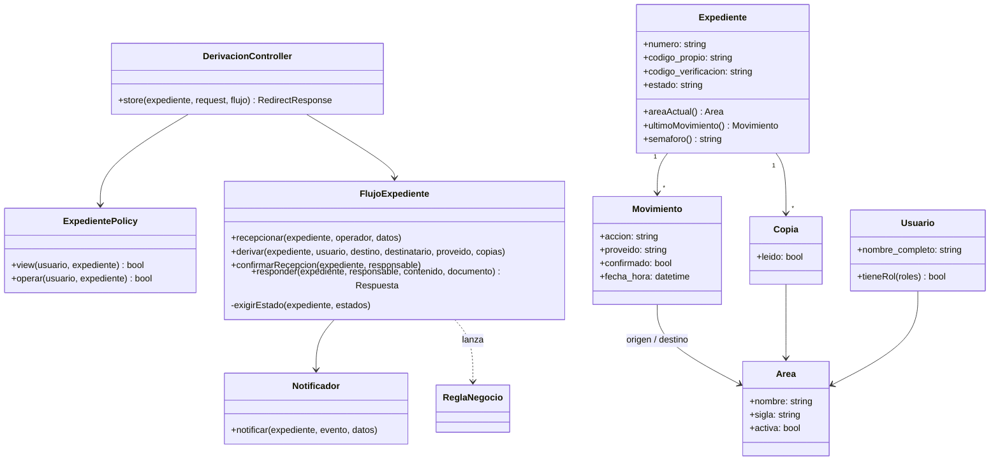

# C4 Nivel 4: Diagrama de código

## 1. Objetivo

Mostrar las clases que participan en el flujo principal del expediente.

## 2. Diagrama de clases

### 2.1. Capas
Control (`DerivacionController`, `ExpedientePolicy`) → Servicios (`FlujoExpediente`, `Notificador`, `Archivos`) → Datos (modelos).

### 2.2. Diagrama UML de clases



### 2.3. Notación
Flecha continua: asociación o uso. Flecha punteada: dependencia. `1 → *`: uno a muchos.

## 3. Diagrama de secuencia: derivar expediente

### 3.1. Descripción
Ver el flujo detallado en [diseño interno](../03-diseno-de-software/diseno-interno/diseno-interno-de-modulos.md#7-flujo-de-ejecución-de-un-caso-de-uso-cu10-derivar).

### 3.2. Diagrama

```mermaid
sequenceDiagram
    actor Op as Operador
    participant C as DerivacionController
    participant P as ExpedientePolicy
    participant F as FlujoExpediente
    participant DB as PostgreSQL
    participant N as Notificador
    Op->>C: POST /expedientes/{id}/derivar
    C->>P: operar()
    C->>F: derivar()
    F->>DB: BEGIN; SELECT ... FOR UPDATE
    alt estado no permitido o destino inválido
        F-->>C: ReglaNegocio
        C-->>Op: aviso
    else correcto
        F->>DB: INSERT movimiento y copias; UPDATE estado = Derivado; COMMIT
        F->>N: notificar("derivación")
        C-->>Op: bandeja con mensaje de éxito
    end
```

## 4. Patrones y principios en este nivel

Service Layer, Policy, Active Record, inyección de dependencias y responsabilidad única (ver [patrones](../03-diseno-de-software/diseno-interno/patrones-de-diseno.md)).

## 5. Consideraciones

Estos diagramas corresponden a la Fig 54 (clases) y a la secuencia del CU10 del análisis ICONIX.
