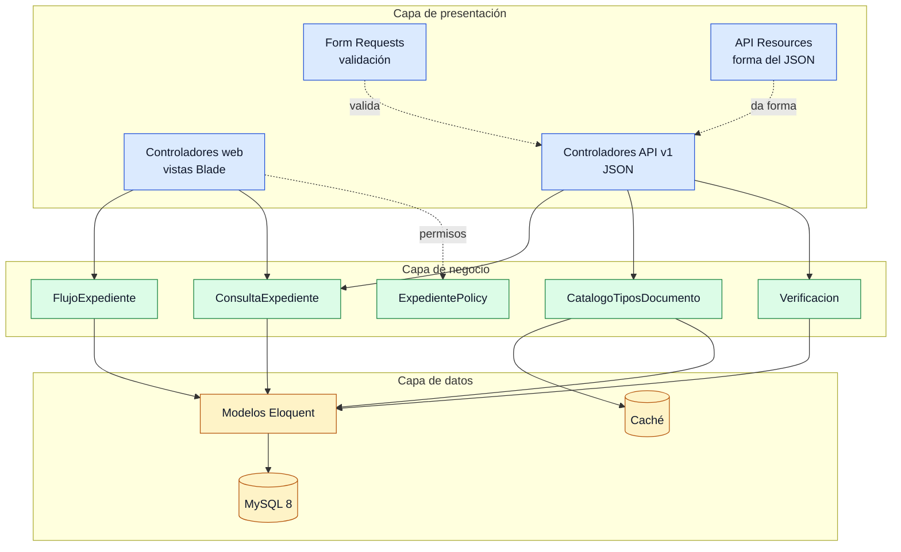
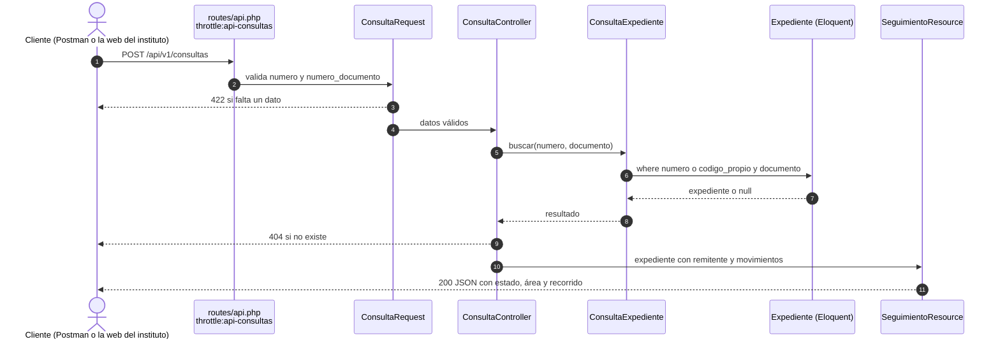

# Estilo y patrón implementados

## 1. Estilo: monolito en capas

Todo el sistema es una sola aplicación Laravel que se despliega junta (DA-01 del Sprint 1). Dentro de ella el código se separa en tres capas. Cada capa solo llama a la de abajo:

| Capa | Carpeta | Qué hace | Ejemplos |
|---|---|---|---|
| Presentación | `app/Http`, `resources/views`, `routes` | Recibe la petición, valida los datos y arma la respuesta (HTML o JSON) | `MesaPartesController`, `Api/V1/ConsultaController`, `ConsultaRequest`, `SeguimientoResource` |
| Negocio | `app/Services`, `app/Policies` | Reglas del trámite: estados, plazos, permisos, firma | `FlujoExpediente`, `ConsultaExpediente`, `CatalogoTiposDocumento`, `Verificacion`, `ExpedientePolicy` |
| Datos | `app/Models`, `database/migrations` | Tablas y relaciones con Eloquent sobre MySQL 8 | `Expediente`, `Movimiento`, `Administrado`, `TipoDocumento` |

La API REST v1 **no es otro sistema**: es otra puerta de entrada al mismo monolito. Sus controladores usan los mismos servicios que las pantallas Blade, así que una regla del negocio se escribe una sola vez.

**Leyenda:** azul es presentación, verde es negocio y amarillo es datos.

### Prueba de que el estilo se respeta

- La búsqueda del expediente estaba dentro de `TramiteExternoController`. En este sprint se movió a `app/Services/ConsultaExpediente.php`, y ahora la usan la pantalla pública y la API. Las pruebas `TramiteExternoTest` (pantalla) y `ConsultaApiTest` (API) pasan con la misma clase.
- El catálogo de tipos de documento lo administran la pantalla del administrador y la API. Ambas pasan por `CatalogoTiposDocumento`, que guarda la auditoría y limpia la caché.
- Ningún controlador de la API escribe SQL ni cambia el estado de un expediente directamente.

## 2. Patrón: MVC

| Parte | En el sistema |
|---|---|
| Modelo | `app/Models` (Eloquent). Por ejemplo `Expediente` con sus relaciones `administrado`, `movimientos`, `tipoDocumento` |
| Vista | Plantillas Blade en `resources/views` para las pantallas. En la API, la "vista" es el **API Resource** que arma el JSON |
| Controlador | `app/Http/Controllers`. Son delgados: validan con un Form Request, llaman a un servicio y devuelven la vista o el JSON |

Ejemplo real del recorrido de una petición de la API:

