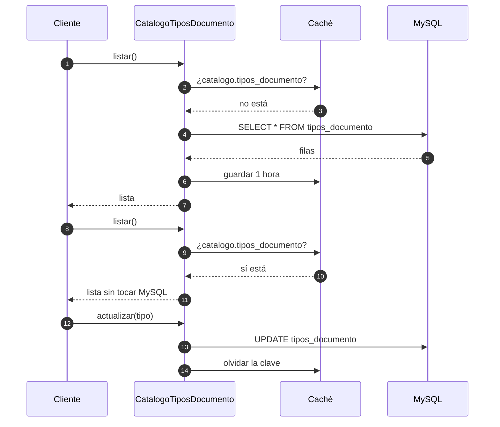

# Comportamiento de la base de datos y estrategia de caché

## 1. Base de datos

- **Motor:** MySQL 8 (InnoDB, `utf8mb4`) en producción. Las pruebas automáticas usan SQLite en memoria para ser rápidas, y el CI repite todas las pruebas sobre MySQL 8 real (trabajo `pruebas-mysql`). Las 165 pruebas también se corrieron sobre MariaDB 10.11 y pasaron todas.
- **Migraciones:** el esquema está en `sistema/database/migrations`. Se crea con `php artisan migrate`.

### 1.1 Índices que usan las consultas más frecuentes

| Consulta | Columnas | Índice |
|---|---|---|
| Buscar expediente por N.° (CU07, API01) | `expedientes.numero` | Único `expedientes_numero_unique` |
| Buscar por código del sello presencial | `expedientes.codigo_propio` | Único `expedientes_codigo_propio_unique` |
| Comprobar el documento del remitente | `administrados.numero_documento` | Único |
| Verificar una constancia (CU19, API02) | `expedientes.codigo_verificacion`, `respuestas.codigo_verificacion` | Únicos |
| Bandejas por estado | `expedientes.estado` | Índice simple |
| Recorrido de un expediente | `movimientos.expediente_id` | Índice de la llave foránea (InnoDB lo crea solo) |
| Copias sin leer de un área | `copias(area_id, leido)` | Índice compuesto |
| Validar un token de la API | `personal_access_tokens.token` | Único |

### 1.2 Plan de ejecución medido

Plan real de la búsqueda de la consulta (obtenido con `EXPLAIN QUERY PLAN` durante las pruebas):

```text
MULTI-INDEX OR
  INDEX 1: SEARCH expedientes USING INDEX expedientes_numero_unique (numero=?)
  INDEX 2: SEARCH expedientes USING INDEX expedientes_codigo_propio_unique (codigo_propio=?)
CORRELATED SCALAR SUBQUERY 1
  SEARCH administrados USING INTEGER PRIMARY KEY (rowid=?)
```

La búsqueda **nunca recorre la tabla completa**: entra por el índice único del número o del código y luego por la llave primaria del administrado. El tiempo no crece con la cantidad de expedientes.

Plan en el motor de la familia MySQL (MariaDB 10.11, compatible con MySQL 8), sobre el esquema real del sistema:

```sql
EXPLAIN SELECT * FROM expedientes
WHERE (numero = 'EXP-2026-000001' OR codigo_propio = 'EXP-2026-000001')
  AND EXISTS (SELECT 1 FROM administrados
              WHERE administrados.id = expedientes.administrado_id
                AND numero_documento = '70451236');
```

| table | type | key | rows | Extra |
|---|---|---|---|---|
| administrados | **const** | `administrados_numero_documento_unique` | 1 | Using index |
| expedientes | **ref** | `expedientes_administrado_id_foreign` | 1 | Using where |

El optimizador empieza por el administrado (índice único del documento, tipo `const`: una sola fila) y luego lee solo los expedientes de esa persona por la llave foránea. En ningún caso aparece `ALL` (recorrido completo de la tabla). En MySQL 8 el optimizador puede elegir otro de los índices de la tabla de arriba, pero siempre entra por un índice.

### 1.3 Cantidad de consultas SQL por petición (problema N+1)

Una consulta de expediente por la API carga el expediente y luego el remitente, los movimientos y las áreas **con carga anticipada** (`load`), en vez de una consulta por cada movimiento.

| Versión | Consultas SQL por petición |
|---|---|
| Primera versión | 6 (el área actual se pedía otra vez a la base de datos) |
| Versión final | 4 (el área actual sale de los movimientos ya cargados) |

La prueba `ConsultaApiTest::test_la_consulta_usa_pocas_consultas_sql_sin_n_mas_1` falla si el número pasa de 5, así que un cambio futuro no puede volver a meter el problema N+1 sin que se note.

### 1.4 Integridad ante acciones simultáneas

- Las operaciones que cambian el estado de un expediente (recepcionar, observar, derivar, responder, finalizar) se hacen dentro de una **transacción** y bloquean la fila con `SELECT ... FOR UPDATE` (`lockForUpdate` en `FlujoExpediente`). Si dos operadores recepcionan a la vez, el segundo espera, ve el estado ya cambiado y recibe el aviso.
- El correlativo `EXP-AAAA-NNNNNN` también se calcula con bloqueo, para que dos trámites presentados en el mismo segundo no reciban el mismo número.
- Eliminar un tipo de documento que usa un expediente está prohibido por regla de negocio (respuesta 409) y por la llave foránea.

## 2. Estrategia de caché

### 2.1 Qué se guarda en caché y qué no

| Dato | ¿Caché? | Motivo |
|---|---|---|
| Catálogo de tipos de documento | **Sí**, 1 hora | Lo lee cada visitante del formulario y casi nunca cambia |
| Estado de un expediente | **No** | Debe ser siempre el real: el ciudadano no puede ver "Recibido" si ya está "Derivado" |
| Verificación de una constancia | **No** | Es una respuesta de autenticidad; debe salir de la base de datos |
| Token de acceso | No | Sanctum lo busca por índice único; es una consulta muy barata |

### 2.2 Patrón usado: *cache-aside* con invalidación

Está en `app/Services/CatalogoTiposDocumento.php`:

1. **Lectura:** `Cache::remember('catalogo.tipos_documento', 3600, ...)`. Si está en caché se devuelve; si no, se lee de MySQL y se guarda.
2. **Escritura:** al crear, actualizar, activar, desactivar o eliminar un tipo (desde la pantalla del administrador o desde la API), el servicio llama a `olvidar()`, que borra la clave. La siguiente lectura trae los datos nuevos.



### 2.3 Evidencia

Medido en las pruebas automáticas (`TiposDocumentoApiTest::test_la_lista_sale_de_la_cache_y_se_renueva_al_cambiar`):

| Petición | Consultas SQL |
|---|---|
| Primera lectura del catálogo | 1 |
| Segunda lectura | **0** (sale de la caché) |
| Lectura después de registrar un tipo | 1, y ya trae el tipo nuevo (la clave se borró al crear) |

### 2.4 Qué se guarda: datos, no objetos

La primera versión guardaba en caché la colección de modelos Eloquent. Las pruebas automáticas pasaban porque usan una caché en memoria que no serializa. En GitHub Actions, la colección de Postman corrió contra el sistema real con caché en archivo y la segunda lectura del catálogo respondió **500**. Laravel 13 no deserializa clases desde la caché (`config/cache.php`, `serializable_classes = false`), para que nadie pueda inyectar objetos si se filtra la clave de la aplicación.

Corrección: la caché guarda solo arreglos con los datos de cada tipo, y el servicio reconstruye los modelos con `TipoDocumento::hydrate(...)`. Se agregó la prueba `test_la_cache_funciona_con_un_almacen_que_serializa` (criterio CA-API03-11), que falla con la versión anterior y pasa con la nueva. Es un ejemplo de por qué se valida la arquitectura con varias herramientas: PHPUnit, Postman y el CI se complementan.

### 2.5 Almacén de caché

- **Desarrollo y hosting compartido:** `CACHE_STORE=database` (tabla `cache`) o `file`. No requiere instalar nada.
- **Si el hosting lo permite:** `CACHE_STORE=redis`. El código no cambia; solo la variable del `.env`.
