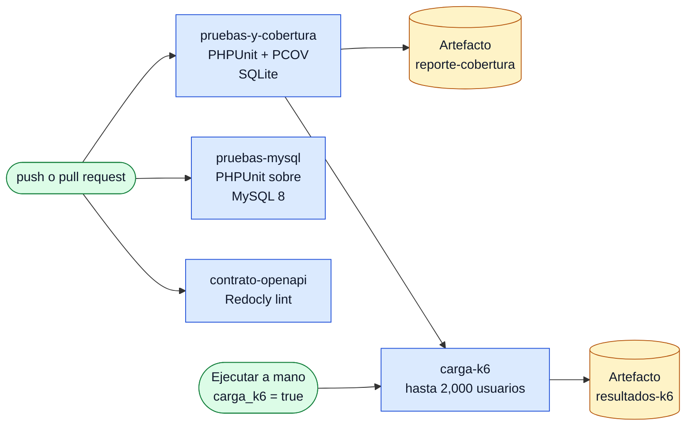

# Pruebas automáticas e integración continua

## 1. Herramienta

La guía usa **Jest** porque el ejemplo está en Node.js. El sistema está en PHP, y el equivalente es **PHPUnit 12**, que viene con Laravel. Se usa igual: cada prueba prepara datos, hace una petición y comprueba la respuesta.

| Jest | PHPUnit con Laravel |
|---|---|
| `describe(...)` | Una clase `...Test` |
| `test('...', () => {...})` | Un método `test_...()` |
| `supertest(app).post('/api/...')` | `$this->postJson('/api/...')` |
| `expect(res.status).toBe(201)` | `->assertCreated()` |
| `jest --coverage` | `phpunit --coverage-html` (con PCOV o Xdebug) |

Cada prueba corre sobre una base de datos **SQLite en memoria** que se crea y se borra sola (`RefreshDatabase`), con los datos de demostración del `DatabaseSeeder`.

## 2. Pruebas del sistema

**165 pruebas, 3 009 comprobaciones, todas en verde** (`php artisan test`, unos 8 segundos).

| Grupo | Archivo | Pruebas |
|---|---|---|
| **API REST v1 (este sprint)** | `tests/Feature/Api/TiposDocumentoApiTest.php` | 11 |
| | `tests/Feature/Api/ConsultaApiTest.php` | 6 |
| | `tests/Feature/Api/TokenApiTest.php` | 3 |
| | `tests/Feature/Api/VerificacionApiTest.php` | 2 |
| | `tests/Feature/Api/ContratoOpenApiTest.php` | 2 |
| Formulario público y seguimiento | `TramiteExternoTest.php`, `CaptchaTurnstileTest.php`, `TerminosCondicionesTest.php` | 43 |
| Mesa de Partes | `RecepcionMesaTest.php`, `RegistroPresencialTest.php`, `InterfazBandejasFormularioTest.php` | 35 |
| Áreas y derivaciones | `FlujoMesaAreaTest.php`, `DerivacionMultipleTest.php`, `InterfazDerivarTest.php`, `AreasOrganigramaTest.php` | 17 |
| Seguridad y acceso | `AccesoTest.php`, `LoginPersonalTest.php`, `SubdominioTest.php` | 9 |
| Firma, PDF y verificación | `PdfFirmaTest.php`, `VerificacionTest.php` | 10 |
| Plazos, búsqueda y administración | `SemaforoTest.php`, `BusquedaBasicaTest.php`, `PanelAdministradorTest.php`, `AdminReportesTest.php`, `MejorasSistemaTest.php` | 24 |
| Control de especificaciones SDD | `EspecificacionesTest.php` | 3 |

### Qué comprueban las pruebas de la API

- Respuestas correctas: 200, 201 con `Location`, 204.
- Errores: 401 sin token, 403 sin rol de administrador, 404, 409 por tipo en uso, 422 con el detalle por campo, 429 al pasarse del límite.
- Que el JSON no tenga datos personales (correo).
- Que el catálogo salga de la caché y se renueve al cambiar.
- Que la consulta de un expediente haga 5 consultas SQL o menos.
- Que cada ruta de la API esté documentada en `openapi.yaml`.

## 3. Integración continua con GitHub Actions

Archivo: [`.github/workflows/ci.yml`](../../.github/workflows/ci.yml). Se ejecuta en cada `push` y en cada pull request a `main`.



| Trabajo | Qué hace | Resultado |
|---|---|---|
| `pruebas-y-cobertura` | Instala PHP 8.4 con PCOV, corre las 165 pruebas y mide la cobertura | Resumen en la página de la ejecución y el artefacto **reporte-cobertura** (HTML, texto, Clover y JUnit) |
| `pruebas-mysql` | Corre las mismas pruebas sobre un MySQL 8 real | Confirma que el sistema funciona con el motor de producción |
| `contrato-openapi` | Revisa `openapi.yaml` con Redocly | Falla si el contrato tiene errores |
| `carga-k6` | Solo cuando se ejecuta a mano: levanta el sistema y lanza k6 | Artefacto **resultados-k6** |

## 4. Reporte de cobertura

1. En GitHub, abrir la pestaña **Actions** y la última ejecución de **CI - Mesa de Partes Virtual**.
2. En el resumen se ve la tabla de cobertura (clases, métodos y líneas).
3. Abajo, en **Artifacts**, descargar `reporte-cobertura` y abrir `cobertura-html/index.html` en el navegador.

Para generarlo en la PC hace falta la extensión PCOV o Xdebug:

```powershell
cd sistema
php vendor/bin/phpunit --coverage-html cobertura-html
```

| Medida | Resultado |
|---|---|
| Pruebas | 165 de 165 en verde |
| Cobertura de líneas | **96.89 %** (1,152 de 1,189 líneas) |
| Cobertura de métodos | **86.64 %** (188 de 217 métodos) |
| Cobertura de clases | **71.93 %** (41 de 57 clases con todos sus métodos cubiertos) |

Medido en GitHub Actions el 27/11/2026 (ejecución #4, PHP 8.4 con PCOV). La cobertura de clases es menor porque una clase solo cuenta si **todos** sus métodos están cubiertos; la de líneas muestra que casi todo el código se ejecuta en alguna prueba.
